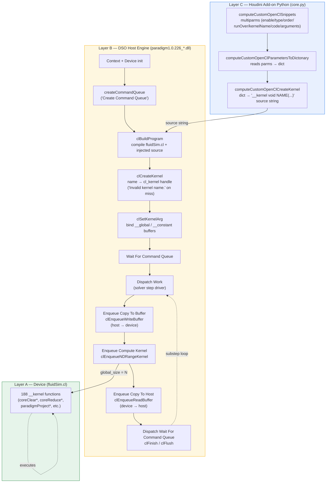

# Paradigm 1.0.226 — OpenCL Dispatch / Enqueue Design

**Complete pseudocode + companion visual diagram.**
Source basis: `compute/openCL/fluidSim.cl` (188 `__kernel` defs), `houdini*/dso/paradigm1.0.226_*.dll` (host dispatch engine), `houdini/scripts/python/PARADIGM_1_0/core.py` (user-kernel injection surface).

---

## 1. Architecture — three layers

| Layer | Component | Role |
|-------|-----------|------|
| **A** | `fluidSim.cl` | OpenCL kernel source (188 `__kernel` functions). Device code only. |
| **B** | `paradigm1.0.226_*.dll` (DSO) | Host engine. Owns the OpenCL context, command queue, and the full dispatch pipeline. Imports 8 OpenCL host APIs. |
| **C** | `PARADIGM_1_0/core.py` (Houdini add-on) | Python surface. Manages user-injected custom kernels via Houdini parameter multiparms. Emits `__kernel` source strings that Layer B compiles and dispatches. |

Data flow: Layer C generates source → Layer B compiles + dispatches → Layer A executes on device.

---

## 2. Visual diagram (Mermaid)



ASCII fallback (if Mermaid not rendered):

```
┌─────────────── Layer C: Python add-on (core.py) ───────────────┐
│  computeCustomOpenClSnippets multiparm                          │
│        │                                                        │
│        ▼                                                        │
│  computeCustomOpenClParametersToDictonary()  → dict             │
│        │                                                        │
│        ▼                                                        │
│  computeCustomOpenClCreateKernel()  → "__kernel void NAME(...)" │
└─────────────────────────┬───────────────────────────────────────┘
                          │ source string
                          ▼
┌─────────────── Layer B: DSO host engine (.dll) ────────────────┐
│  init context + device                                          │
│        │                                                        │
│        ▼                                                        │
│  clBuildProgram (fluidSim.cl + injected source)                 │
│        │                                                        │
│        ▼                                                        │
│  clCreateKernel(name)  ──► "Invalid kernel name." on miss       │
│        │                                                        │
│        ▼                                                        │
│  clSetKernelArg(...)  ×N args                                   │
│        │                                                        │
│        ▼                                                        │
│  Wait For Command Queue                                         │
│        │                                                        │
│        ▼                                                        │
│  ┌─► Dispatch Work  (solver substep)                            │
│  │      │                                                       │
│  │      ▼                                                       │
│  │   clEnqueueWriteBuffer  (host → device)                      │
│  │      │                                                       │
│  │      ▼                                                       │
│  │   clEnqueueNDRangeKernel  ──────►  Layer A: device kernels   │
│  │      │                                                       │
│  │      ▼                                                       │
│  │   clEnqueueReadBuffer   (device → host)                      │
│  │      │                                                       │
│  │      ▼                                                       │
│  └─  clFinish / clFlush  (Dispatch Wait For Command Queue)      │
│            │                                                    │
│            └─ next substep or idle                              │
└─────────────────────────────────────────────────────────────────┘
```

---

## 3. Complete dispatch pseudocode

### 3.1 Engine initialization (once per solver)

```
FUNCTION InitializeEngine(devicePrefs):
    platform ← SelectPlatform(devicePrefs.platformIndex)
    device   ← SelectDevice(platform, devicePrefs.deviceType)        # GPU/CPU
    IF device IS NULL:
        FAIL "Failed to set device when creating the command queue."

    context  ← clCreateContext(platform, [device], notifyCallback)
    queue    ← clCreateCommandQueue(context, device, properties)

    IF queue IS NULL:
        FAIL "Failed to create command queue!"
    IF queueAlreadyCreated:
        FAIL "COMPUTE::Manager::createCommandQueue() -> A command queue is already
              created, to create a new command queue you must reset!"

    # Compile the canonical kernel source (188 kernels) plus any user injections.
    sourceBundle ← fluidSim.cl
    FOR each userKernel IN pendingUserKernels:
        sourceBundle ← sourceBundle + userKernel.source

    program ← clBuildProgram(context, [device], sourceBundle, compileOptions)
    IF buildFailed:
        FAIL BuildLog(program)

    # Pre-create kernel handles for every name we will dispatch.
    kernelTable ← {}        # name → cl_kernel
    FOR each name IN ALL_KERNEL_NAMES ∪ userKernelNames:
        kernelTable[name] ← clCreateKernel(program, name)
        IF kernelTable[name] IS NULL:
            FAIL "Invalid kernel name."   # name not in compiled program
    RETURN (context, queue, kernelTable)
```

### 3.2 Per-kernel dispatch primitive

```
FUNCTION DispatchKernel(queue, kernelTable, name, globalSize, localSize, args):
    kernel ← kernelTable[name]
    IF kernel IS NULL:
        FAIL "Invalid kernel name."
    IF queue IS NULL:
        FAIL "Invalid command queue."

    # 1. Bind every argument in declaration order.
    FOR i, arg IN ENUMERATE(args):
        clSetKernelArg(kernel, i, arg.size, arg.pointer)

    # 2. Enqueue. OpenCL requires non-null global size; local may be NULL (driver picks).
    clEnqueueNDRangeKernel(
        queue, kernel,
        workDim      = globalSize.dimensions,        # 1, 2, or 3
        globalOffset = NULL,
        globalSize   = globalSize,
        localSize    = localSize,                    # tile / workgroup size
        waitList     = [],
        event        = OUT event
    )
    RETURN event
```

### 3.3 Buffer copy primitives (host ↔ device sync)

```
FUNCTION CopyToBuffer(queue, hostPtr, deviceBuffer, bytes):   # "Enqueue Copy To Buffer"
    clEnqueueWriteBuffer(queue, deviceBuffer, BLOCKING=FALSE,
                         offset=0, bytes, hostPtr, waitList=[], event=OUT ev)
    RETURN ev

FUNCTION CopyToHost(queue, deviceBuffer, hostPtr, bytes):     # "Enqueue Copy To Host"
    clEnqueueReadBuffer(queue, deviceBuffer, BLOCKING=FALSE,
                        offset=0, bytes, hostPtr, waitList=[], event=OUT ev)
    RETURN ev
```

### 3.4 Command-queue synchronization

```
FUNCTION WaitForCommandQueue(queue):    # "Wait For Command Queue"
    clFlush(queue)                      # submit all queued work
    clFinish(queue)                     # block until drained

# "Dispatch Wait For Command Queue" — variant used after Dispatch Work:
FUNCTION DispatchWaitForCommandQueue(queue):
    clFinish(queue)
```

### 3.5 One solver substep (the "Dispatch Work" driver)

```
FUNCTION DispatchWork(state, queue, kernelTable):
    # 'state' carries every __global field buffer + __constant parameter structs.

    # --- A. Push dirty host data into device buffers ---------------------
    FOR each dirtyField IN state.dirtyFields:
        CopyToBuffer(queue, state.host[dirtyField], state.device[dirtyField],
                     state.fieldBytes[dirtyField])

    # --- B. Run the per-substep kernel pipeline (order matters) ----------
    # Concrete ordering mirrors fluidSim.cl solver phases; shown generically.

    DispatchKernel(queue, kernelTable, "coreClearScalarInt32",
                   globalSize = state.cellCount,
                   localSize  = TILE_3D,
                   args = [state.device.voxelType])

    DispatchKernel(queue, kernelTable, "coreComputeMaxActiveValue",
                   globalSize = state.cellCount, localSize = TILE_3D,
                   args = [state.device.density, state.device.maxActiveOut])

    DispatchKernel(queue, kernelTable, "coreConvertFieldVectorToMagnitude",
                   globalSize = state.cellCount, localSize = TILE_3D,
                   args = [state.device.velX, state.device.velY, state.device.velZ,
                           state.device.velMag])

    # Reduction family — note the per-tile-size variants (Linear128/256/512/1024).
    DispatchKernel(queue, kernelTable, "coreReduceSum1024",
                   globalSize = ReduceGroups(state.cellCount, 1024),
                   localSize  = 1024,
                   args = [state.device.density, state.device.partialSums])

    DispatchKernel(queue, kernelTable, "paradigmProjectNonDivergentJacobi16_",
                   globalSize = state.cellCount, localSize = TILE_3D,
                   args = [state.device.pressure, state.device.velocity,
                           state.params.standardValues, state.params.sparseOctree,
                           ...])

    # ... 180+ further dispatches for advection, viscosity PCG, SDF, particles,
    #     whitewater, sources, sparse-octree sync — each via DispatchKernel(...).

    # --- C. Pull results back to host for Houdini visualization -----------
    FOR each readableField IN state.readFields:
        CopyToHost(queue, state.device[readableField], state.host[readableField],
                   state.fieldBytes[readableField])

    # --- D. Drain ----------------------------------------------------------
    DispatchWaitForCommandQueue(queue)
```

### 3.6 Top-level solve loop

```
FUNCTION Solve(solverState, frameRange):
    (context, queue, kernelTable) ← InitializeEngine(solverState.devicePrefs)

    FOR frame IN frameRange:
        FOR substep IN 1..solverState.substeps:
            solverState.standardValues.time      ← ComputeTime(frame, substep)
            solverState.standardValues.timeStep  ← ComputeTimeStep(solverState)
            DispatchWork(solverState, queue, kernelTable)
            DispatchWaitForCommandQueue(queue)

    # Optional final drain.
    clFlush(queue); clFinish(queue)
```

---

## 4. User-kernel injection path (Layer C → Layer B)

This is the surface the add-on Python exposes. A user defines a kernel in Houdini
via the `computeCustomOpenClSnippets` multiparm; the add-on materializes its source
and feeds it into the same Layer B pipeline above.

### 4.1 Read parameters → dict

```
FUNCTION computeCustomOpenClParametersToDictonary(self):
    data ← { result: [], success: TRUE, error: "" }

    countParm ← self.c_node.parm("computeCustomOpenClSnippets")
    IF countParm IS None:
        RETURN error(data, "Missing the computeCustomOpenClSnippets parameter!")

    keys = ["enable", "type", "order", "runOver", "kernelName", "code"]
    argKeys = ["mode", "field", "fieldPermissions",
               "constantType", "constantName",
               "constantValueFloat", "constantValueInt"]

    FOR i IN 1..countParm.evalAsInt():
        entry ← {}
        FOR key IN keys:
            parm ← self.c_node.parm("computeCustomOpenCl" + capitalize(key) + str(i))
            entry[key] ← EvalByTemplateType(parm)        # toggle/int/float/string/menu
        entry.arguments ← []
        argCountParm ← self.c_node.parm("computeCustomOpenClArguments" + str(i))
        FOR a IN 1..argCountParm.evalAsInt():
            argEntry ← {}
            FOR key IN argKeys:
                pn ← "computeCustomOpenClArguments" + str(i)
                     + capitalize(key) + str(a)
                argEntry[key] ← EvalByTemplateType(self.c_node.parm(pn))
            entry.arguments.append(argEntry)
        data.result.append(entry)

    RETURN standardOutputToString(data)
```

### 4.2 Build kernel source string

```
FUNCTION computeCustomOpenClCreateKernel(self, calledParm, onlyUpdateHeader=FALSE):
    data ← stringToStandardOutput(self.computeCustomOpenClParametersToDictonary())
    IF NOT data.success:
        popUpMessage(data.error); RETURN

    index ← trailingDigits(calledParm.name())        # multiparm index
    entry ← data.result[index - 1]                   # 1-based → 0-based
    codeParm ← self.c_node.parm("computeCustomOpenClCode" + str(index))

    out ← "__kernel void " + entry.kernelName + "(\n\n"

    # Map each argument into a typed __global / scalar parameter.
    FOR arg IN entry.arguments:
        IF arg.mode == FIELD:
            type ← "field_t"            # or "voxelType_t", "float" for position
            suffixes ← [""] | ["_x","_y","_z"] | ["_r","_g","_b"]   # by field name
            IF arg.fieldPermissions IN {Write, ReadWrite}:
                FOR s IN suffixes: out += "__global {type} * a_{field}Write{s},\n"
            IF arg.fieldPermissions IN {Read, ReadWrite}:
                FOR s IN suffixes: out += "__global {type} * a_{field}Read{s},\n"
        ELSE IF arg.mode == CONSTANT:
            out += "{arg.constantType} a_{arg.constantName},\n"

    # Standard tail arguments every kernel receives.
    out += "__constant struct CoreParametersOpenClStandardValues * a_standardValues,\n"
    out += "__constant struct CoreParametersSparseOctree * a_sparseOctree,\n"
    out += "__constant int * a_sparseOctreeRootSubElements,\n"
    out += "__global   int * a_sparseOctreeSubElements,\n"
    out += "__global   int * a_sparseOctreeStart\n) {\n"

    IF onlyUpdateHeader:                # preserve existing body, swap header only
        existingBody ← splitByCodeHeader(codeParm.evalAsString())[1]
        codeParm.set(out + existingBody); RETURN

    # Emit index computation based on runOver mode.
    IF entry.runOver == VoxelTile:
        out += "    int l_x = get_local_id(0);\n"
        out += "    int l_y = get_global_id(1);\n"
        out += "    int l_z = get_global_id(2);\n"
        out += "    int l_leafIndex = get_group_id(0);\n"
        out += "    index_t l_index = coreGetVoxelIndexLocal(l_leafIndex, l_x, l_y, l_z);\n"
        IF voxelTypeReadOrWrite: out += "    if(a_voxelType{RW}[l_index] & Bit_Core_VoxelType_Collision) return;\n"
        out += "    int l_start_x, l_start_y, l_start_z;\n"
        out += "    coreGetStartVectorL0(l_leafIndex, &l_start_x, &l_start_y, &l_start_z, a_sparseOctreeStart);\n"
        out += "    l_x += l_start_x; l_y += l_start_y; l_z += l_start_z;\n"
        out += "    float l_worldPosition_x = (float)(l_x) * Const_Core_OctreeVoxelDivisionSize;\n"
        # ... y, z ...
    ELSE IF entry.runOver == VoxelLinear:
        out += "    index_t l_index = get_global_id(0);\n"
        IF voxelTypeRW: out += "    if(a_voxelType{RW}[l_index] & Bit_Core_VoxelType_Collision) return;\n"
    ELSE IF entry.runOver == Particles:
        out += "    index_t l_index = get_global_id(0);\n"

    # Templated usage hints (commented) for standard values + field access.
    out += "    //a_standardValues[0].solverTimeStep;\n"
    out += "    //float l_fieldValue = coreReadFieldValue(l_index, a_fieldArgument);\n"
    out += "    //coreWriteFieldValue(l_fieldValue, l_index, a_fieldArgument);\n"
    out += "}\n"

    codeParm.set(out)        # ← Layer B reads this on next clBuildProgram
```

### 4.3 How Layer B picks up an injected kernel

```
# During the next InitializeEngine / rebuild pass:
userKernels ← collect "computeCustomOpenClCode<N>" parms → source strings
program     ← clBuildProgram(context, [device], fluidSim.cl + userKernels, opts)
# Each user kernel now has a cl_kernel handle in kernelTable and is dispatched
# by name via DispatchKernel() exactly like a built-in kernel.
```

---

## 5. Dispatch contract — invariants

1. **One context, one command queue per solver.** Re-creation requires explicit reset
   (enforced by the `"already created"` diagnostic).
2. **Kernel handles are pre-created at build time**, not lazily — every dispatch is an
   O(1) `clEnqueueNDRangeKernel` lookup by handle, never a rebuild.
3. **Argument order is fixed.** `clSetKernelArg` index `i` must match the `i`-th
   parameter declaration in the `__kernel` source (built-in or user-injected).
4. **User kernels receive the standard 5-arg tail** (`a_standardValues`,
   `a_sparseOctree`, `a_sparseOctreeRootSubElements`, `a_sparseOctreeSubElements`,
   `a_sparseOctreeStart`) — enforced by the header generator in §4.2.
5. **Host-visible fields are pulled back with `clEnqueueReadBuffer`** only on fields
   tagged Read/ReadWrite; Write-only fields stay resident.
6. **Every `Dispatch Work` substep ends with `clFinish`** — no cross-substep
   implicit dependency.

---

## 6. Failure modes (from DSO diagnostic strings)

| Diagnostic string | Trigger | Layer |
|-------------------|---------|-------|
| `"Failed to create command queue!"` | `clCreateCommandQueue` returned NULL | B |
| `"Failed to set device when creating the command queue."` | No matching device for prefs | B |
| `"COMPUTE::Manager::createCommandQueue() -> A command queue is already created, ..."` | Second init without reset | B |
| `"Invalid command queue."` | Dispatch invoked after queue teardown | B |
| `"Invalid kernel name."` | `clCreateKernel` miss (name not in compiled program) | B |
| `"Missing the {parm} parameter!"` / `"The {parm} parameter is missing!"` | Houdini multiparm absent | C |
| `"The {parm} parameter type is unknown!"` | Unexpected `hou.parmTemplateType` | C |
| `"Unknow button triggered kernel creation!"` | Callback parm lacks trailing digits | C |

---

## 7. Cross-reference to artifacts

| Concept | Where it lives |
|---------|----------------|
| 188 device kernels | `compute/openCL/fluidSim.cl` |
| Host dispatch APIs (8) | `houdini*/dso/paradigm1.0.226_*.dll` import table |
| Dispatch diagnostics | DSO string table |
| `computeCustomOpenClParametersToDictonary` | `houdini/scripts/python/PARADIGM_1_0/core.py:607` |
| `computeCustomOpenClCreateKernel` | `houdini/scripts/python/PARADIGM_1_0/core.py:761` |
| Per-kernel enqueue map | `C:\Users\Tyler\Desktop\paradigm_mapping_verify.txt` |
| Verbatim enqueue/dispatch snippets | `C:\Users\Tyler\Desktop\paradigm_enqueue_dispatch.py` |
| Kernel name references | `C:\Users\Tyler\Desktop\paradigm_kernel_names.txt` |
