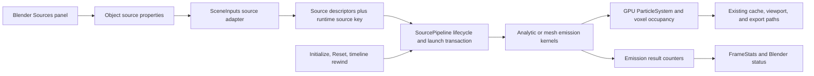

# Source Emission Product Plan

## Executive decision

The addon needs a user-facing emission lifecycle separate from its inherited
solver representation enum.

The standard source workflow for this addon will be:

1. **Emission Behavior**
   - **Initial Fill**: fill the selected source region once, on the first
     enabled solver step after Initialize or Reset.
   - **Continuous Inflow**: restore the selected source region to its target
     particle occupancy every solver substep while Enabled.
2. **Source Region**
   - Analytic sources use their signed-distance interior.
   - Mesh sources offer **Solid Volume** for validated watertight meshes and
     **Surface Shell** for open or surface emitters.
3. **Activation**
   - The existing keyframeable **Enabled** property controls when a source may
     act. Disabling and re-enabling an Initial Fill source does not re-arm it;
     Initialize or Reset does.
4. **Particle density**
   - New sources use the domain's **Particles / Voxel** target.
   - The existing per-source `emit_rate` storage remains as an advanced legacy
     occupancy override, relabeled **Target Particles / Voxel**. It is not a
     liquid-volume or volume-per-second rate.
5. **Velocity and attributes**
   - Initial velocity, object-velocity inheritance, temperature, viscosity,
     density attribute, and optional lifespan apply identically to Initial Fill
     and Continuous Inflow.

This matches familiar liquid-source product semantics: Blender separates a
one-time Geometry source from an Inflow and lets **Use Flow** animate
activation; it also distinguishes mesh surface emission. SideFX similarly
separates source activation from source operations and explicitly normalizes
per-time additive sourcing. References:

- [Blender Fluid Flow manual](https://docs.blender.org/manual/en/5.0/physics/fluid/type/flow.html)
- [Blender FluidFlowSettings interface](https://docs.blender.org/api/current/bpy.types.FluidFlowSettings.html)
- [SideFX Volume Source](https://www.sidefx.com/docs/houdini/nodes/dop/volumesource.html)

An arbitrary **Volume / Second** control is not part of this fix. For a FLIP
inflow, world-space flux follows source cross-section, velocity, and activation
duration; particle occupancy controls sampling quality. Adding a second,
competing rate model would obscure that contract.

## Truth contract

The completed product must make these claims true:

- Initial Fill emits the configured region once, regardless of CFL substep
  count, and re-arms only on Initialize or Reset.
- Continuous Inflow replenishes while Enabled and remains stable when voxel
  size or adaptive substep count changes.
- Solid Volume means particles are sampled inside the analytic or watertight
  mesh volume, not on a proxy shell.
- Surface Shell means particles are sourced from a bounded shell and is labeled
  as such.
- Particle density controls sampling density, not emitted world-space volume.
- Capacity-limited or invalid source fills are visible failures/warnings, not
  silent partial success.
- UI labels, documentation, demos, tests, and runtime behavior describe the
  same implementation.

## Claim and gap matrix

| Claim | Current implementation | Status | Required action |
|---|---|---:|---|
| Continuous particle inflow | `k_source_shapes_particles` and `k_mesh_source_particles` top each voxel up every solver substep | Partial | Keep the core behavior; name it **Continuous Inflow**, fix boundary sampling and diagnostics |
| Initial volume/fill | No volume-fill lifecycle; only direct point/vertex injection | Missing | Add per-source Initial Fill state in `SourcePipeline` |
| Analytic solid volume | Voxel-center membership followed by unconstrained jitter | Partial | Estimate boundary coverage and guarantee emitted samples remain inside the SDF |
| Mesh solid volume | Mesh particle sources always project to a triangle shell | Missing | Reuse the existing watertight validation and parity containment path for solid particle emission |
| Mesh surface source | Triangle shell and projection are implemented and tested | Conformant | Preserve and expose it explicitly as **Surface Shell** |
| Per-source `Emit Rate` | It is actually target particles per voxel | Nonconformant label | Remove the label; use domain occupancy by default and retain a truthful advanced override |
| `Mode = Field` creates liquid | False premise: primary-source `fluidSim.cl` shows FIELD writes source pressure only and never marks fluid, active, or tracking bits | Corrected | Removed from the normal Sources UI; retained as a saved-file compatibility enum. Pressure-field sourcing remains deferred; object role **Force** now applies analytic shape acceleration in the forces phase after P2G. |
| One-shot point injection | Mesh, point-cloud, and particle-system points can be directly injected | Conformant compatibility utility | Move out of the main volume-emission workflow and label **Inject Points Once (Compatibility)** |
| Auto point seed on reset | `auto_inject_seed` is implemented and used on Initialize/Reset | Partial exposure | Expose only in the compatibility point-injection section or keep hidden if no point workflow is selected |
| Blender Volume source | NanoVDB/Warp volume kernels exist and have direct kernel validation; no Blender adapter or `SourcePipeline` descriptor calls them | Kernel-only proxy | Do not advertise as supported. Treat as a separate adapter milestone |
| Source density | `density` is transferred as a particle attribute, not physical liquid mass | Partial/misleading if exposed | Label **Density Attribute** in Advanced Attributes; never call it material density |
| Blend and Feather | Properties and bridge wiring exist; they affect field-mode sourcing, not normal particle fill | Compatibility-only | Keep hidden with field-mode compatibility; do not add them to the primary source UI |
| Demo source truth | Canonical dam-break preview is built with direct particle injection while the saved source is a continuous high-occupancy emitter | Nonconformant | Rebuild canonical source-driven demos using Initial Fill and verify saved playback through the real path |

## Existing implementation inventory

### Exposed today

- `properties.py`: Enabled, Analytic/Mesh geometry, analytic shape,
  `SourceShapeSourceMode`, `emit_rate`, velocity, temperature, viscosity, and
  lifespan.
- `panels.py`: those controls plus mesh evaluation and Surface Band.
- `scene_inputs.py`: converts analytic and evaluated mesh sources to
  `SourceShapeDesc` or `MeshSourceDesc` each simulated frame.
- `sourcing.py`: analytic field stamping, analytic particle top-up, mesh shell
  field stamping, mesh shell particle top-up, height fill, and direct point
  injection.

### Implemented but not normally exposed

- `auto_inject_seed`: repeats direct point injection after Initialize/Reset.
- `blend_mode` and `feather`: live field-mode controls.
- `density`: live particle attribute transfer.
- Warp/NanoVDB scalar, vector, fog, SDF, and mask source kernels.
- Direct point extraction from mesh vertices, Blender point clouds, and the
  first particle system on an object.
- Watertight mesh validation and orientation-independent parity containment,
  currently used only by solid mesh sinks.

### Misleading or incomplete surfaces

- `Mode = Field` was shown as a peer liquid-source mode although the original
  defines it as pressure influence without particle/liquid creation. It is now
  hidden from the normal Sources UI and retained only as a compatibility enum.
- `Emit Rate` has no time unit and is not a rate.
- Module documentation says the Blender bridge converts OpenVDB to NanoVDB,
  but no such bridge exists.
- **Inject Mesh Vertices Once** is global in the Sources panel even though it is
  a compatibility point import, not volume emission.

## Intended product behavior

### Emission Behavior

`INITIAL_FILL`

- Eligible on the first sourcing call where the source exists, is Enabled, and
  passes validation.
- Emits at most once per solver lifetime.
- Is not repeated for later substeps in the same display frame.
- Is not re-armed by Enabled animation, object movement, renaming, mesh
  reevaluation, or scene synchronization.
- Is re-armed by solver Initialize, Reset, timeline rewind that resets the
  solver, and fresh cache-sequence simulation.
- Uses a stable runtime source key derived from the Blender object pointer;
  identity remains stable across renames but does not need persistence beyond
  the solver lifetime.

`CONTINUOUS_INFLOW`

- Runs once per solver substep while Enabled.
- Tops the selected region up to target occupancy; it does not blindly append
  a fixed particle count.
- Uses current source transform and, when selected, the current evaluated mesh.
- Uses the existing keyframeable Enabled property as activation.

Default policy:

- Existing sources preserve current behavior because the new property defaults
  to Continuous Inflow.
- **Tag Source** creates a Continuous Inflow unless the caller explicitly asks
  for Initial Fill.
- Quick Setup and dam-break/initial-condition presets explicitly create Initial
  Fill sources.

### Source Region

Analytic geometry:

- Sphere, cylinder, box, pyramid, cone, and the bounded plane/half-space use the
  existing analytic SDF.
- Particle candidates are accepted only when their sample position is inside
  the intended SDF region.
- Boundary occupancy is estimated deterministically so represented volume
  converges as voxel size decreases and does not jump solely because a voxel
  center crosses the boundary.

Mesh geometry:

- **Solid Volume** requires a non-empty, non-degenerate, watertight evaluated
  mesh. It uses the existing parity containment helper and emits interior
  particles.
- **Surface Shell** retains current closest-triangle shell behavior and Surface
  Band.
- Open meshes remain valid for Surface Shell and are rejected with the existing
  per-object error surface for Solid Volume.
- First Sim Frame versus Every Sim Frame remains a geometry-capture choice. For
  Initial Fill, Every Sim Frame is disabled in the UI because later evaluations
  cannot emit again before reset.

Compatibility defaults:

- The new mesh source-region property defaults to Surface Shell so existing
  `.blend` files preserve their current output.
- New product presets that represent an initial liquid body select Solid Volume
  explicitly.

### Occupancy and volume consistency

- A filled voxel normally targets `scene.fluidsim.particles_per_voxel`.
- Add `use_domain_particles_per_voxel`; `Tag Source` sets it true.
- Existing saved sources default it false and continue using their stored
  `emit_rate` value for compatibility.
- When false, display the stored property as **Target Particles / Voxel** under
  Advanced Sampling.
- The physical-volume test proxy is
  `particle_count * voxel_size^3 / target_particles_per_voxel`.
- Overlapping analytic and mesh sources must share updated voxel occupancy so
  two sources do not both top up from the same stale pre-emission count.
- Per-source custom occupancy is sampling density, never an emission-flow rate.

### Capacity and errors

- Add a small GPU emission-result buffer containing emitted count and a
  capacity-limited flag.
- Initial Fill is marked consumed after its launch. If capacity is exhausted,
  the frame and session status report a partial initial fill and instruct the
  user to increase Max Particles and Reset.
- Continuous Inflow reports capacity limitation without repeating noisy errors
  every substep.
- Invalid Solid Volume mesh sources do not consume their Initial Fill latch;
  they may emit after the mesh becomes valid.

## Seam map

| Seam | Current owner | Change |
|---|---|---|
| Product vocabulary | `sim/enums.py` | Add Blender-native `SourceEmissionBehavior` and `MeshSourceRegion`; do not alter synthesized enum values |
| Persistent Blender state | `properties.py` | Add behavior, source region, and domain-occupancy toggle; retain legacy storage |
| UI ownership | `panels.py` | Render behavior-first controls, conditional region/sampling sections, and compatibility point injection |
| Blender adapter | `blender/scene_inputs.py` | Resolve defaults, runtime source identity, watertight validation, and descriptor fields |
| Runtime source interface | `sim/sourcing.py::SourcePipeline` | Own consumed Initial Fill keys, reset, eligible-source filtering, launch results, and all emission kernels |
| Solver lifecycle | `sim/solver.py` | Delegate reset to `SourcePipeline`, include source emission results in `FrameStats`, keep solver calls shallow |
| Scene lifecycle/status | `blender/scene_bridge.py` | Surface partial fills/capacity warnings without owning source semantics |
| Compatibility points | `blender/sources.py`, `operators.py` | Retain direct point injection; relabel and remove it from the primary volume workflow |
| Demos | `tools/build_demo_scenes.py`, canonical `.blend` files | Replace direct-injection proof with real Initial Fill sources where the scene claims replayable source behavior |
| Documentation | `docs/user_guide.md`, `docs/technical_report.md` | Document units, lifecycle, regions, compatibility lanes, and actual Volume-kernel status |
| Verification | existing source, mesh, bridge, panel, Blender acceptance, and production-gate tests | Test through these existing seams rather than adding a parallel test framework |

The deep module remains `SourcePipeline`: the solver knows only `set_source_batch`,
`apply(dt)`, `reset_runtime()`, and an emission result. Blender-specific
properties and objects stop at `SceneInputs`; GPU sampling details remain inside
the pipeline implementation.

## Change disposition

### Add

- `SourceEmissionBehavior`: `INITIAL_FILL`, `CONTINUOUS_INFLOW`.
- `MeshSourceRegion`: `SOLID_VOLUME`, `SURFACE_SHELL`.
- Blender properties for behavior, mesh source region, and domain occupancy.
- Host-only `source_key`, behavior, and region fields on source descriptors.
- Initial Fill consumed-key state and `reset_runtime()` in `SourcePipeline`.
- Solid mesh particle emission using the existing watertight/parity seam.
- Deterministic boundary coverage and inside-position checks.
- Emission count/capacity result reporting.
- Behavioral tests for lifecycle, volume convergence, overlaps, solid/surface
  mesh behavior, UI conditions, reset, saved playback, and capacity warnings.

### Adjust

- Reuse `emit_rate` storage as the legacy **Target Particles / Voxel** value.
- Update voxel occupancy during emission so later overlapping sources see
  particles emitted earlier in the same sourcing transaction.
- Make Height Fill use the same Initial Fill/Continuous Inflow lifecycle with a
  stable built-in source key.
- Make Quick Setup and demo builders choose behavior explicitly.
- Make saved-demo validation assert that the product source path—not a direct
  injection stand-in—created the initial liquid.
- Update source documentation and technical phase ordering.

### Remove from the primary UI

- `Mode = Field / Particles`.
- The label `Emit Rate`.
- The top-level **Inject Mesh Vertices Once** action.
- Field-only Blend and Feather controls from any normal particle-source view.

These compatibility implementations are retained internally; removal from the
primary UI is not deletion of synthesized kernels or existing `.blend` data.

### Correct or remove false claims

- Replace the statement that the Blender bridge converts OpenVDB to NanoVDB
  with the truth: Warp volume kernels exist, but there is no Blender Volume
  adapter yet.
- Stop describing direct point injection or prebuilt demo particle arrays as
  proof of volume-source behavior.

### Do not change

- Synthesized enum numeric values in `fluidSim_synth/enums.py` or
  `SourceShapeSourceMode`.
- Sparse 8x8x8 leaf-grid storage.
- GPU-resident particle and field buffers.
- Existing surface-shell mesh path, direct point-injection interface, or cache
  output schema unless required by diagnostics.

## Implementation phases

### Phase 0 — Protect the live worktree

1. Record the current diff for every overlapping source file before editing.
2. Preserve the existing uncommitted force-system, demo, docs, and test work.
3. Make source-emission changes as narrow hunks; do not reset, clean, stash, or
   replace whole files.
4. Run the current focused baseline, already observed as:
   `74 passed in 2.77s` for sourcing, mesh source, scene bridge, and panel tests.

Checkpoint: the existing diff remains present and source work can be separated
from unrelated force changes by inspection.

### Phase 1 — Lock the behavior contract with failing tests

1. Extend `tests/test_sourcing_pipeline.py` with Initial Fill eligibility,
   one-launch-per-reset, delayed activation, re-enable behavior, height-source
   lifecycle, and reset tests.
2. Extend `tests/test_mesh_source_pipeline.py` with solid-volume containment,
   surface-shell preservation, open-mesh rejection, overlap occupancy, and
   capacity-result tests.
3. Add a deterministic analytic volume-convergence test using the existing
   sphere source at multiple voxel sizes.
4. Extend scene-adapter tests for runtime keys, property translation, domain
   occupancy resolution, and compatibility defaults.
5. Extend panel tests to assert visible/hidden controls by behavior and region.

Checkpoint: new tests fail for missing lifecycle/solid-volume behavior while
the pre-existing source tests remain green.

### Phase 2 — Introduce the product seam

1. Add the two Blender-native enums without modifying synthesized enums.
2. Add persistent properties and truthful descriptions.
3. Extend `SourceShapeDesc`, `MeshSourceDesc`, and `HeightSourceDesc` with
   host-only behavior/identity/region metadata.
4. Translate Blender objects in `SceneInputs`; use `obj.as_pointer()` as the
   runtime key and resolve domain versus legacy occupancy there.
5. Add `SourcePipeline.reset_runtime()` and call it from `FluidSolver.reset()`.
6. Filter eligible sources inside `SourcePipeline.apply(dt)` and mark Initial
   Fill sources consumed after one launch.

Checkpoint: lifecycle tests pass using the existing emission kernels.

### Phase 3 — Correct GPU emission semantics

1. Change analytic emission to compute deterministic boundary occupancy and
   accept only sample positions inside the analytic SDF.
2. Update per-voxel occupancy as particles are emitted so overlapping analytic
   and mesh sources cannot double-fill from stale counts.
3. Generalize mesh particle membership:
   - Solid Volume: parity containment and interior sampling.
   - Surface Shell: retain closest-triangle projection.
4. Add per-launch emitted/capacity counters with no full-particle readback.
5. Keep launch dimensions bounded by active sparse voxels and preserve GPU
   ownership of particle growth.

Checkpoint: analytic volume proxy meets tolerance, all particles satisfy region
membership, overlap does not overfill, and mesh solid/surface tests pass.

### Phase 4 — Complete Blender UI and compatibility behavior

1. Make the Sources panel behavior-first and conditional.
2. Hide inherited Field/Particles mode from the normal workflow.
3. Rename the stored custom occupancy control and show it only when domain
   occupancy is disabled.
4. Show Solid Volume/Surface Shell only for mesh geometry; show Surface Band
   only for Surface Shell.
5. Disable Every Sim Frame mesh evaluation for consumed-by-design Initial Fill
   configuration.
6. Move direct point injection to a clearly labeled compatibility section and
   conditionally expose Auto Inject Seed.
7. Surface mesh validation and capacity-limited fill errors in the existing
   object/session status areas.

Checkpoint: mocked panel tests and real Blender GUI panel-draw acceptance pass.

### Phase 5 — Align demos, playback, and documentation

1. Make `make_source_box` require an explicit behavior argument.
2. Convert the playable dam-break source to Initial Fill and domain occupancy.
3. Remove direct particle injection as the evidence path for any demo claiming
   source-driven playback; keep it only in explicitly named compatibility
   fixtures.
4. Update demo metadata with source behavior, region, occupancy source, and
   measured initial particle/volume proxy.
5. Update the user guide and technical report.
6. Correct the NanoVDB bridge claim and document Volume kernels as kernel-only.

Checkpoint: regenerated canonical demos reopen, reset, and produce their initial
liquid through the same source path exposed in the UI.

### Phase 6 — Verification and cleanup

Run in this order:

1. `python -m pytest -q tests/test_sourcing_pipeline.py tests/test_mesh_source_pipeline.py tests/test_scene_bridge_collider_cache.py tests/test_operator_panel_behavior.py`
2. `python -m pytest -q`
3. `blender --background --factory-startup --python tests/blender_mesh_source_acceptance.py`
4. `blender --background --factory-startup --python tests/blender_handler_persistence_gate.py`
5. `blender --background --factory-startup --python tests/blender_background_acceptance.py`
6. `python tools/run_production_gate.py`
7. `python tools/run_production_gate.py --include-gui`
8. Rebuild and validate canonical demos with the documented demo workflow.
9. Inspect the final diff for unrelated worktree changes and stale labels such
   as `Emit Rate`, primary `source_mode`, or false Volume-adapter claims.

## Acceptance criteria

1. A selected Source visibly offers Initial Fill or Continuous Inflow.
2. Initial Fill emits once across any number of solver substeps, emits nothing
   further until reset, and re-emits after reset.
3. A source disabled at reset may fire once when first enabled; later
   disable/re-enable cycles do not re-arm it.
4. Continuous Inflow replenishes vacancies while Enabled and stops when
   disabled.
5. For the reference radius-0.25 sphere, normalized represented volume is
   within 10% at voxel size 0.10 and within 4% at 0.05 and 0.025; every emitted
   particle is inside the analytic source.
6. Changing adaptive substep count over the same simulated duration changes
   continuous emitted physical-volume proxy by no more than 10% in the
   reference moving-inflow case.
7. Overlapping sources do not exceed the selected target occupancy merely
   because multiple descriptors overlap.
8. Solid mesh sources fill the interior of a watertight mesh; Surface Shell
   sources retain current triangle-projected behavior; open Solid Volume meshes
   produce an actionable error.
9. Capacity-limited initial fills are explicitly reported and never presented
   as complete.
10. Existing saved sources retain Continuous Inflow, Surface Shell, and custom
    occupancy behavior unless the user changes the new controls.
11. New Quick Setup/dam-break initial-condition sources use Initial Fill and
    domain particle occupancy.
12. Canonical saved-demo playback proves the real source path rather than a
    pre-injected stand-in.
13. The full Python suite, headless production gate, and GUI production gate
    pass without weakening existing tests.

## Separate Volume-object milestone

The existing Warp volume kernels are not enough to expose **Geometry: Volume**.
A truthful implementation requires a Blender Volume adapter that resolves
animated VDB paths and grids, converts or uploads them to `wp.Volume`, owns
cache invalidation, supplies topology bounds, and integrates particle creation
through `SourcePipeline`. Blender exposes Volume datablocks and grid metadata,
while Warp can load NanoVDB or NumPy volume data, but the repository currently
contains no OpenVDB-to-NanoVDB bridge.

Therefore this emission fix must quarantine the claim, not add a dropdown that
cannot work. Implement Blender Volume sourcing as a separately accepted
milestone after the Initial Fill/Continuous Inflow contract ships.

## Critical path and risks

Critical path:

`behavior tests -> descriptor/product seam -> SourcePipeline state -> GPU region
sampling -> UI/bridge -> demos -> full gates`

Primary risks:

- The worktree has overlapping uncommitted edits in source, solver, bridge,
  panels, docs, tests, and demos; implementation must preserve them hunk by hunk.
- Mesh parity queries are more expensive than shell projection. Restrict them
  to Solid Volume sources and active sparse voxels, then profile the user path.
- Boundary coverage must be deterministic across runs and independent of
  adaptive substep count.
- A host-side Initial Fill latch must survive per-frame descriptor rebuilding
  but clear on every real solver reset.
- Legacy high `emit_rate` demos may change appearance when moved to domain
  occupancy; they must be retuned through geometry/velocity, not by restoring a
  misleading flow-rate label.
- Volume kernels must not be mistaken for a complete Blender Volume feature.

No subagent split is recommended for implementation while the worktree remains
dirty across the same core files. The safest sequence is serialized ownership
of `sourcing.py`, `scene_inputs.py`, `properties.py`, and `panels.py`, followed
by independent review after the integrated diff is executable.
