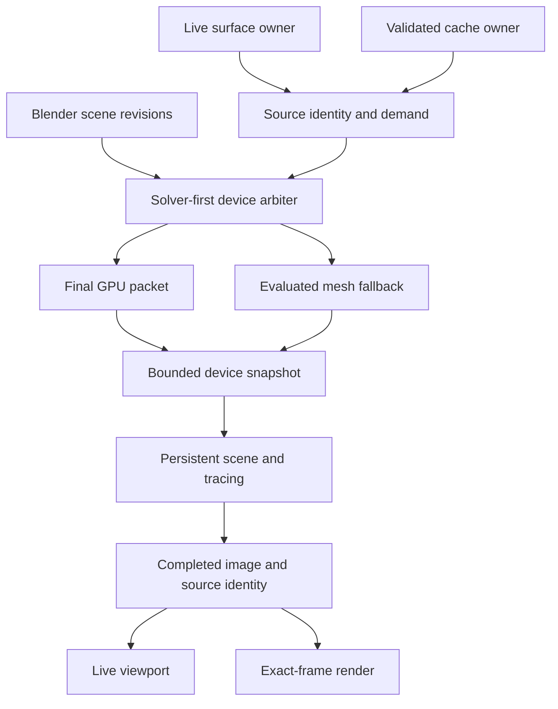

# FSPT live bridge design snapshot

Source: https://chatgpt.com/space/page_bfe819484c448191951c75b707b2d507
Sequence: 2, updated 2026-11-26T16:18:13Z. The Page remains authoritative.

## Visual evidence and canonical FSPT image

Include original screenshots, renders or output captures for visible changes and verified workflows. Keep raw performance and lifecycle receipts alongside the visual evidence. Caption each capture with its date, exact source or installer, runtime/device, scene and settings, scope and durable original. Label historical or static-fixture evidence with its actual scope.

Maintain one recognizable representative image from real FSPT output and label it Provisional or Selected. The existing P1 static render remains provisional. The existing FSPT runtime owner should capture a live FluidSim look-development workflow during admitted qualification and review the canonical image then. For source-only or blocked work, record the reason and the next owned capture task.

**Optimized design, 26 November 2026.** Build the production Live bridge around FluidSim’s final GPU surface, bounded renderer-owned device snapshots and solver-first rendering. Keep Blender’s evaluated mesh as the first correctness proof and explicit compatibility fallback. Remove avoidable extraction, transfers, allocation and synchronization before pursuing advanced rendering algorithms.

This covers the P2 fluid bridge and P3 realtime boundary. The [FSPT roadmap](https://chatgpt.com/space/page_e736fb28ec2881918bc688878f62ab03) owns phase scope, compatibility, optical gates and the joint image-quality/freshness/solver-overhead contract. This Page defines bridge mechanics. These optimizations are designed; implementation, real GPU acceptance and performance measurements remain pending.

# Decision and alternatives

| Approach | Benefit | Cost and disposition |
| --- | --- | --- |
| Final GPU surface with renderer-owned device snapshots | Avoids the bulk surface GPU→CPU→Blender→GPU round trip on eligible outputs; solver storage can be reused after copying, independently of tracing | Production Live design in P2/P3. Qualify final-surface parity, ownership, bounded copies, current runtime and actual solver interference. |
| Published surface through evaluated Blender mesh | Preserves Blender modifiers and gives an independent comparison using P1 extraction | First 24-state functional proof, permanent reference and explicit fallback for unsupported GPU-route semantics. Measure its host overhead and label the route. |
| Direct alias of producer device storage | May remove a device copy | Later measured optimization only if lifetime is safe and retaining storage cannot stall solver reuse. A raw pointer or double buffering alone is insufficient. |
| Validated cached geometry | Repeatable visual and renderer benchmark | Separate lane; it cannot establish fresh live simulation. Preserve cache validation and source identity. |

Use the existing Warp software BVH and host presentation for the first bounded proof. Qualify in-process RTX acceleration and GPU image presentation early in parallel; neither is already available merely because CUDA rendering works. Keep one source/scene contract across backends. The roadmap records the current warp-optix Python ABI blocker and requires a supported route for the existing Blender runtime before adoption.

The design must preserve the existing solver, Surface Waves, Sheet Detail, playback catch-up, cache validation, authoritative bake, output ownership and render-frame restoration. FSPT consumes published state. Rendering a frame never authorizes FSPT to step, reset, rebake or change solver quality.

# Source baseline

The inspected experimental worktree is `C:/Users/Tyler/projects/fluidsim-fspt-20261125`, branch `experimental/fspt-p1-20261125`, at `49aa02be60a28cc9f3af06c797a4bcf07c42b850`. [Draft PR 89](https://github.com/trdillman/Warp-FluidSim-Addon/pull/89) contains the P1 foundation. Its evidence identifies runtime candidate `0ece56afe51b88b3a42f7596b65ba58f750f36b5`; subsequent commits through the inspected head are documentation and evidence.

A separate local repair, `2ecebfcf3aec109b949e8192e061dcd1d4d25383`, changes device-selection acceptance and the shared bounce limit in four FSPT files. Reconcile its ownership and integration before implementation; this design does not replace that work. Untracked experiment evidence also exists and must be preserved.

Three source facts determine the design:

- P1 already accepts owned evaluated triangle arrays of changing sizes. Its missing live contract is publication identity, readiness, scheduling and qualification. `SceneSnapshot.digest` currently combines geometry, materials, world and timeline frame; any change makes `CudaBackend._set_scene()` recreate the complete GPU mesh. [Extraction](https://github.com/trdillman/Warp-FluidSim-Addon/blob/49aa02be60a28cc9f3af06c797a4bcf07c42b850/fluidSim_warp_blender51/blender/fspt_scene.py) · [Contracts](https://github.com/trdillman/Warp-FluidSim-Addon/blob/49aa02be60a28cc9f3af06c797a4bcf07c42b850/fluidSim_warp_blender51/fspt/contracts.py) · [Backend](https://github.com/trdillman/Warp-FluidSim-Addon/blob/49aa02be60a28cc9f3af06c797a4bcf07c42b850/fluidSim_warp_blender51/fspt/backend.py).

- `output_publication.py` owns surface mutation. A cadence skip retains old surface geometry while particle publication can advance. Its current `PublishedPoints.frame_id` is not a surface or solver-state identity. Publication is not transactional: an in-place mesh can be cleared before a later error. [Publication source](https://github.com/trdillman/Warp-FluidSim-Addon/blob/49aa02be60a28cc9f3af06c797a4bcf07c42b850/fluidSim_warp_blender51/blender/output_publication.py).

- `HostFrame.surface_mesh → FluidSolver.surface_mesh() → SurfacePipeline.mesh()` produces the final simulator surface, including render surfacing and wave displacement. Raw extraction GPU buffers can precede world conversion or displacement and have different lifetimes; they also precede Blender modifiers. [Surface pipeline](https://github.com/trdillman/Warp-FluidSim-Addon/blob/49aa02be60a28cc9f3af06c797a4bcf07c42b850/fluidSim_warp_blender51/sim/surface.py) · [Surface Waves](https://github.com/trdillman/Warp-FluidSim-Addon/blob/49aa02be60a28cc9f3af06c797a4bcf07c42b850/fluidSim_warp_blender51/sim/surface_waves.py).

# Ownership and data flow

| Owner | Bridge responsibility |
| --- | --- |
| simulation_admission.py and existing session lifecycle | Issue an epoch on committed admission/cutover; invalidate eligibility on retirement. Preserve failed-admission/reset behavior. |
| scene_bridge.py | Supply solver state through the existing session path. No renderer stepping entry point. |
| Existing SurfacePipeline and live/cache preparation owners | Aggregate output demand; produce the final GPU surface and completion/ownership facts; preserve all stateful SDF, Sheet Detail and wave work. Materialize host output whenever required by an existing consumer. |
| output_publication.py | Live/cache adapters capture source facts; expose per-channel readiness, publication generations and notifications. Keep publish_payload independent of solver/HostFrame/Warp access. Preserve mutable-host quarantine. |
| playback.py | Preserve source selection, cache validation, catch-up, errors and render restoration. Unpublished intermediate steps do not fabricate surface generations. |
| New blender/fspt_bridge.py plus fspt_scene.py | Reserve capture capacity; select eligible GPU or evaluated route; produce owned immutable renderer records and matching scene revisions. Never change playback policy. |
| fspt/contracts.py, backend.py and scheduler | Validate identity; manage shared scene assets, bounded device-wide submissions, image history and event-based retirement. |
| fspt_engine.py | Connect supported callbacks, UI and completed presentation. Copy provenance from the submitted job into telemetry. |

Authoritative Production Cache Bake continues to bypass Output Publication. FSPT receives those results only through the established validated cache-playback route. Preserve the existing public render hooks, including admission/visibility setup and post-render frame restoration. [Ownership rules](https://github.com/trdillman/Warp-FluidSim-Addon/blob/49aa02be60a28cc9f3af06c797a4bcf07c42b850/AGENTS.md) · [Render hooks](https://github.com/trdillman/Warp-FluidSim-Addon/blob/49aa02be60a28cc9f3af06c797a4bcf07c42b850/fluidSim_warp_blender51/blender/render.py).

# Publication contract

Add a small immutable SurfacePublication descriptor plus a typed DeviceSurfacePacket for the GPU route. These are proposed API names. Source identity is common; geometry route and channel readiness are explicit. Source identity and the underlying surface build key are shared facts. Successful publication generation is scoped to epoch, output owner and geometry channel; a commit never advances or certifies another channel. Numeric generations from different channels are not interchangeable.

| Field group | Required meaning |
| --- | --- |
| Ownership | Runtime scene token, admitted domain/output-owner token, session epoch and output identity. Names/raw Blender pointers alone do not survive deletion/reuse/reload safely. |
| Source | LIVE, CACHE or explicitly historical preview. Live carries actual solver state revision/frame/time; cache carries validated identity/revision and actual cache frame. Timeline mapping comes from playback. |
| Surface | Successful channel-scoped generation, surface build/settings key, actual source state, topology/position/attribute revisions, active counts and visibility. Requested timeline frame is separate. |
| Geometry route | GPU_FINAL or EVALUATED_MESH, capability/eligibility revision and fallback reason. Never bypass an unsupported modifier or required attribute. |
| Readiness | Per-channel READY, EMPTY, UNCHANGED, PENDING or ERROR with reason; separate attempt counter, last committed generation and mutation quarantine. For a committed GPU packet, READY still requires consumers to obey its completion event. |
| Device packet | Device/context, typed layout/stride, capacity and active counts, final position/index/normal/attribute owners, producer-ready event and copy-release/retirement contract. |
| Scene join | Transform, material, visibility and required channel revisions captured at a declared coherent scene boundary. Unchanged static records may be reused. |
| Timing | Host monotonic timestamps with declared state/publication/capture meanings; GPU event durations are separate clock measurements. |

A new paused reconstruction or surface-settings change may create a new surface generation without advancing the timeline. A new timeline frame does not establish a new surface. Source provenance must describe the state actually used to construct the surface; an earlier cached surface must retain its earlier build key/state even when the adapter is called from a newer solver state.

Use existing `SurfacePipeline.build_key()` and liquid-state revisions where available, but do not substitute a settings digest or grid-topology generation for a session epoch or triangle-connectivity revision.

Keep the last committed descriptor separate from each current channel attempt, error and sticky mutable-output quarantine. GPU-owned data cannot be certified by an unrelated successful particle/host update; a valid retained packet also does not make a partially mutated Blender mesh safe to read. Missing or failed required scene inputs prevent committing the new render scene.

`PublishedPoints` remains its existing interface. Point/whitewater changes cannot manufacture a new surface generation. The surface descriptor may expose other channel availability for diagnostics; native point rendering remains a separate capability.

# Final GPU surface protocol

Reserve a renderer slot and check current demand before requesting FSPT-only materialization. The upstream surface/output owner supplies final world-space positions, connectivity, geometric/shading data and required attributes, after the render-surface recipe, Sheet Detail and current wave displacement. The existing dense host world-conversion and wave readbacks must be removed or bypassed by a parity-tested device path; merely exposing sparse marching-cubes buffers does not satisfy this contract.

Commit GPU and evaluated-host channels independently under the same source identity/build key, with distinct channel-scoped publication generations. The GPU packet requires valid final surface data and matching required transforms/materials/visibility; its ready event orders device consumers without a CPU/device-wide wait. A required scene-channel failure prevents the new render scene from becoming eligible. A host-only channel failure may leave an already owned GPU packet usable only when that channel is proven irrelevant to its scene; otherwise conservatively reject it. Host mutation quarantine and render-input synchronization still govern the evaluated route.

At the source publication boundary, reserve destination capacity and bounded copy admission before acquiring a source lease. Validate device/layout/counts and enqueue the copy after producer-ready on a qualified transfer/producer stream, without dependencies on unrelated tracing or acceleration work. Count source-lease queue delay as well as copy execution; if bounded admission is unavailable, skip capture before leasing the allocation. The producer cannot overwrite or free that source allocation until copy-complete. It need not wait for tracing. If no slot or copy budget exists, skip FSPT capture; retain only a descriptor and reacquire a current generation through the owner later. A delayed descriptor is never permission to dereference an expired source pointer.

After the copy and required validation complete, build/refit a candidate using renderer-owned storage, with no mutation of resources still read by an old job. Swap the active record only after successful completion and a matching epoch/scene check. Preserve the prior owned record only while eligible. Return source and destination leases at their different completion points; fixed pool capacity includes every retired generation.

Host materialization may be skipped only when the existing owner’s consumer-demand decision proves it unnecessary. An unsupported modifier, another viewport, exporter or required output keeps the host path active. Surface cadence remains explicit; no fresh state is invented on skipped materialization. Admission must not skip stateful after_frame work, solver-dependent SDF/whitewater work, Sheet Detail/wave evolution or authoritative bake. The current wave update itself includes host extraction, so a full GPU route needs a real parity-preserving surface-pipeline change. [Inspected surface implementation](https://github.com/trdillman/Warp-FluidSim-Addon/blob/49aa02be60a28cc9f3af06c797a4bcf07c42b850/fluidSim_warp_blender51/sim/surface.py).

Capability changes invalidate route eligibility. Re-evaluate modifiers, transforms, visibility and attribute requirements on their revisions, not every draw. If an unsupported effect appears, switch to the evaluated route with a new accepted snapshot/history and a visible diagnostic; do not silently omit the effect. No raw-pointer sharing, inferred vertex correspondence or undeclared geometry simplification is permitted.

# Evaluated-mesh commit and capture protocol

1. For the evaluated route, the live adapter update_outputs or cache adapter update_outputs_from_cache_frame captures source identity before adapting the payload. Before any potentially mutating publication, mark the attempted host replacement pending. Never read a partially updated output.

2. Existing host publication and rigid-output updates run through their current owners. Only a successful enclosing host update can commit its replacement descriptor. Keep publish_payload free of solver access. A recoverable RenderInputSyncResult(synchronized=False) leaves this route pending until the existing owner restores render inputs; it is not a new fatal simulation exception. GPU-channel commit follows the separate protocol above and must prove its own required scene inputs.

3. A successful surface update commits `READY`, or `EMPTY` for an authoritative empty/cleared result. On cadence skip, retain the prior surface generation and its original source stamp. Advance any independent particle metadata normally.

4. Notify weak scene-scoped subscribers with identity/status only; contain notification errors in renderer diagnostics. Check render capacity and demand before optional FSPT capture. Publication must not recursively extract Blender meshes or render.

5. After admission, a supported Blender callback validates owner/epoch/status, copies the evaluated mesh into owned storage and rechecks publication/evaluation revisions. Retry at a later evaluation boundary if needed and always release to_mesh data. Multiple views share the accepted geometry snapshot; do not repeat extraction per view or draw.

6. Upload/build a candidate GPU snapshot and swap the active renderer record only after validation and successful completion. An exception leaves the previous renderer-owned snapshot intact where it is still eligible. No rollback of the producer’s Blender mesh is assumed.

`ERROR` after possible mutation sets a sticky quarantine on the producer output. A later cadence skip, an unrelated successful update or a render-input-sync-only retry cannot clear it. Recovery requires a complete successful surface replacement or explicit clear through the output owner, plus completion of the enclosing publication/rigid-update path. The next eligible owner update may force surface republication for recovery without advancing the solver; it may not accept a skipped payload as recovery. A failure proved to occur before any mutation leaves the previous committed producer surface intact, while reporting the new attempt's error.

A render-input-sync warning alone is a distinct pending case: after the surface and remaining publication work completed successfully, a successful sync-only retry may expose that exact generation if no later mutation or epoch change occurred. This cannot clear mutation quarantine. A valid zero-triangle publication removes the prior fluid from tracing. Empty temporary arrays from `publish_surface=False` do not remove it. A removed or disabled owner also invalidates its geometry explicitly.

Live mode may retain a visibly labelled last valid image from the same eligible scene/session while a replacement is pending. After reset, scene/domain switch, load or retirement, an old epoch is ineligible. Final rendering refuses a pending, invalid, unknown or wrong-frame publication. Its preparation routes readiness through the existing playback/output owner: an already solved current state may be force-published with the existing `force_surface=True` path, without another solver step. A missing arbitrary frame must be supplied through established playback/cache policy or fail clearly.

# Geometry reuse and change keys

The evaluated reference preserves modifiers, final displaced positions, visibility, transforms/reflected winding, material ownership and required attributes. Producer vertices are already world-space in the current output path; apply the actual evaluated object transform exactly once. The GPU route must prove equivalent final coordinates and surface meaning, including Waves and Sheet Detail, and cannot add an assumed second domain transform. Unsupported effects select the evaluated route explicitly.

Introduce per-output immutable geometry records and separate change keys:

| Change | GPU scene action | Image action |
| --- | --- | --- |
| Camera or integrator settings | Reuse geometry/acceleration | Start new radiance history. |
| Resolution | Resize/grow image storage only | Start new image history. |
| Material parameters, world/light edits | Update affected shading records; geometry-affecting displacement is classified separately | Reset radiance history. |
| Material assignments/attributes | Validate and update affected records; honor backend layout requirements | Reset history where radiance changes. |
| Object transform, fixed geometry | Update qualified instance data; software reference updates only affected baked positions | Reset history. |
| Vertex positions, proven fixed connectivity/order | Update positions/normals and use qualified refit; first smoke may rebuild | Reset history. |
| Indices, active counts, primitive layout or owner replacement | Rebuild affected geometry, including equal-count connectivity changes; retain static assets | Reset history. |
| Authoritative empty surface | Remove it from ray queries | Reset history. |
| Timeline change without render-input change | No fluid geometry work; retain original provenance | No false new solved state or unnecessary history reset. |

Use independent authoritative revisions for topology, positions, transforms, attributes, shading, camera and image settings. Do not compute full vertex/index SHA hashes at every draw. Fingerprint or validate content at admitted capture/build boundaries and in acceptance evidence. A modifier can change topology independently, and counts alone never prove connectivity. Validation on the GPU may return bounded status/count metadata; removing bulk readback must not remove validation.

The first smoke uses full rebuild as the reference. The next P2 slice separates static scene and fluid assets and makes buffers, acceleration scratch and image storage persistent within bounded capacities. Every nearest-hit query must cover all active assets with correct material mapping. Refit/rebuild may not mutate structures still used by tracing. Software Warp needs a small explicit multi-mesh query contract; hardware instance/acceleration APIs remain backend-specific.

Warp 1.18 supports point changes followed by `Mesh.refit()`; changed indices require a new `Mesh`. Enable refit only after equivalence and total refit-plus-trace measurements. [Warp 1.18 mesh contract](https://nvidia.github.io/warp/v1.18/user_guide/runtime.html#meshes).

Carry geometric normals separately from evaluated shading normals. The P1 kernel currently uses geometric normals. Smooth-normal handling and correct boundary orientation must be verified before claiming the complete P2 liquid appearance gate; a bounded bridge smoke may retain the explicitly recorded P1 optical subset.

# Live scheduling and history

Use one device-level arbiter across scenes/views, with scene-scoped publishers and per-view camera/history/image state. Initially admit one rendering quantum at a time plus a bounded copy/build candidate, under one combined memory budget. Share immutable geometry among views and measure fair service. Final rendering acquires the same arbiter and pauses new viewport submissions while pinning its exact state; existing playback owns stepping and restoration. Avoid duplicate replacement liquid/particle preview passes in the FSPT viewport while preserving requested diagnostics, required visible channels and other viewports/output consumers.

| Mode | Scheduling contract |
| --- | --- |
| Live | One newest pending descriptor per eligible view, shared source capture and bounded device work. Reserve a slot/deadline before optional materialization. Drop obsolete pending work before copy/build; count skipped states. Finish useful current-epoch work instead of perpetual restart. |
| Paused refinement | Pin an accepted snapshot and use available render budget until a real input changes. Edits do not step the solver. |
| Final render | Pin the exact requested live/validated cached state; render required samples or fail clearly. No latest-only frame drops. Sequence stepping remains with playback/export. |

A completed job carries epoch, source identity/state, geometry route, channel publication generation, capability/eligibility revision, surface build and geometry keys, scene/shading revisions, camera, dimensions and integrator settings. Validate completion against that immutable submitted tuple, then validate current lifecycle/view/route eligibility at presentation. Copy it into RenderFrame and _frame_info; never relabel old pixels with the then-current scene.frame_current.

A newer fluid publication may make a current-epoch image lagging; it can be shown with its real state and age while newer work is pending. Reset, scene/owner/source transition, incompatible camera/shading changes, or a capability/modifier change invalidating its geometry route reject the result even when solver frame and epoch numbers match. A LIVE-to-CACHE transition invalidates the old source despite matching frame numbers. These rules avoid starvation without treating stale or ineligible output as current.

Initially reset accumulation for every changed fluid snapshot and every radiance-changing edit. Repeated draws and paused samples do not count as new fluid states. Do not infer vertex correspondence from particle IDs or reuse temporal history across remeshing. Temporal reconstruction and refractive motion guides remain later P3 work.

Use plain status text such as “Live · surface 48 · timeline 51 · 1 sample”, “Refining · surface 48 · 32 samples” or “Waiting for surface · showing 48”. Keep implementation diagnostics in an expandable status panel and evidence output.

# GPU lifetime and responsive presentation

The first 24-state smoke may retain P1 synchronization as an explicitly bounded reference. P2/P3 then split submission, completion polling and acquisition. Schedule bounded work from supported Blender callbacks; view_draw only presents completed images and handles draw-context resources. No device-wide wait or full image download per progressive sample on the optimized route. Compile and reserve capacity before steady measurements.

Start with two renderer-owned geometry slots within the frozen VRAM budget, plus explicitly bounded image/history/transfer pools. Active, candidate and retired records all consume that fixed capacity; retirement never creates an extra slot. A full pool drops optional new capture instead of blocking the solver behind tracing. Pending metadata retains identity, not a mutable producer pointer. Geometry, acceleration, shader tables and launch parameters stay alive until their last GPU use; image storage also waits for graphics fences before reuse.

Prove GPU image presentation independently from geometry sharing. Use persistent display resources only through supported, verified Blender/native APIs. Until then, the fallback uses a bounded pinned-host pool and copies/uploads only completed images at presentation cadence, with transfer/allocation cost recorded. Do not assume SDK positions_texture is an RGBA transport or that GPUTexture exposes external handles. Resize, graphics backend, device matching, color management and teardown each need evidence; final-result readback is scheduled separately.

Do not add a persistent Python worker that accesses live Blender objects. Blender documents distinct update/draw callbacks and warns against ongoing Python threads. Verify the selected timer, redraw, callback and GPU APIs in the actual 5.2 build before qualifying them; newer documentation is guidance, not runtime acceptance. [RenderEngine](https://docs.blender.org/api/5.3/bpy.types.RenderEngine.html) · [Threading guidance](https://docs.blender.org/api/main/info_gotchas_threading.html).

Cancellation stops future submissions at bounded dispatch boundaries and quarantines obsolete results; it does not preempt a running kernel. Measure tile/ray-batch duration and indivisible copy/acceleration-build duration. Lower stream priority is only a scheduling hint, not isolation. Admit work against solver deadlines and measured interference; do not create an unbounded GPU queue. Teardown stops demand/submissions, drains owned work through existing cleanup and releases only safe resources. A timeout/device fault cannot justify freeing in-use allocations.

Use producer-ready, copy-complete, render-complete and graphics-complete events/fences for their distinct lifetimes. The copy-complete event releases the producer lease; it must not wait for the full trace. This still consumes GPU bandwidth and may delay reuse briefly, so include it in paired overhead measurements. Direct aliasing is optional only after demonstrating safe retention and lower total cost. [Warp concurrency and lifetimes](https://nvidia.github.io/warp/v1.18/user_guide/execution_and_performance/concurrency.html) · [CUDA scheduling](https://docs.nvidia.com/cuda/cuda-programming-guide/02-basics/asynchronous-execution.html).

# Material and channel boundary

P1 accepts constant Diffuse, smooth Glass and Emission with a constant world. It rejects Principled graphs, linked attributes/textures, rough shaders, point clouds and other unsupported components. Existing fluid material and whitewater settings must therefore be checked before launching the bridge fixture. [P1 translator](https://github.com/trdillman/Warp-FluidSim-Addon/blob/49aa02be60a28cc9f3af06c797a4bcf07c42b850/fluidSim_warp_blender51/blender/fspt_scene.py).

Use an explicitly prepared, disposable copy of an existing live scene with a supported Glass material for the first plumbing proof. Keep its original authoritative domain, source and simulation path. Record any disabled visible point/whitewater channel as a fixture restriction. Do not alter the user's working scene or silently substitute a water shader.

The broader gate still requires the normal FluidSim liquid material, evaluated normals, color/attribute semantics, appropriate lights/world, thin-interface and translated-coordinate controls, nested dielectrics and the roadmap's optical criteria. Whitewater/foam/spray/bubble availability and unsupported visibility must be reported, not silently omitted. A passing bridge fixture cannot mark full P2 or P3 complete.

# Acceptance and evidence

| Check | Required proof |
| --- | --- |
| First visible bridge | At least 24 genuinely changing solved states from an existing reopenable FluidSim scene, corresponding surface generations/FSPT images, pause/refine/resume. This is the evaluated reference smoke. |
| Provenance | Cadence/catch-up retain prior source stamps; same-frame rebuild creates a new generation; validated cache has actual identity; saved preview never passes as live. |
| Final GPU parity | Final world conversion, Waves, Sheet Detail, normals/attributes and materials match the evaluated reference. Exercise supported route and explicit modifier fallback; raw extractor arrays are not enough. |
| Geometry | Changing counts, equal-count changed connectivity, empty transitions, reflected/nonuniform transforms, material mapping and refit/full-rebuild equivalence. |
| Failure | Host mutation followed by cadence skip, sync warning, late required-scene failure; GPU validation/copy/build/dispatch/presentation faults. Reject the intended channel/generation and preserve only eligible owned output. |
| Lifetime | Attempt producer reuse before copy completion, delayed old-epoch completion, refit while old readers exist, full slot pool and graphics reuse before fence. Retire safely without unbounded allocation. |
| Lifecycle | Reset/reused frames, failed/successful admission, undo/redo, delete/replace, source/scene/domain change, GPU-to-evaluated route change after a modifier/capability edit with old GPU completion delayed, real viewport resize, engine/device switch, cancellation and save/reopen. |
| Solver preservation | Redraws never step the solver. Match deterministic results or numerical invariants; preserve stateful surface/wave/whitewater work, other consumers and independent bake. |
| Structural efficiency | Camera/shading-only edits do not rebuild geometry; unchanged draws do not extract/hash; full slots drop work before materialization; multiple views share assets; no active consumer means no recurring FSPT work. |
| Expanded live | 240 changing states, 50 lifecycle cycles and ten-minute soak; device-wide arbitration, bounded memory, joint fresh-image/quality/solver-overhead acceptance from the roadmap. |
| Delivered artifact | Source tests and actual Blender acceptance, then exact packaged candidate in a private profile; repeat every claimed route and record loaded paths/hash. |

## Gates by delivery slice

- **First source bridge smoke:** the 24-state live sequence, pause/refine/resume, cadence/catch-up provenance, same-frame rebuild, valid-empty and changed-count/connectivity controls, reset/reused-frame rejection, and proof that redraws do not step the solver. Through the actual publication path, inject a failure after mesh mutation followed by a cadence skip, and a separate render-sync warning; require correct quarantine/recovery. Preserve existing P1 static and GPU-failure regressions. Use real Blender/CUDA for the claimed visible route and relevant boundary controls; pure identity/state-machine cases may be host tests.

- **GPU surface and reuse slice:** add final GPU/evaluated parity, output-demand preservation, copy/producer-reuse ordering, explicit fallback, static/fluid material mapping, refit-versus-rebuild and capacity/allocation controls. Add paired bridge-cost evidence and retain the first smoke. A different tracing backend also needs the same reference/optical checks.

- **Asynchronous live slice:** require event retirement, delayed-completion and lifecycle controls, multi-scene/view/final arbitration, full-slot/deadline behavior, actual image transport, 240 states, 50 cycles and ten-minute soak. A realtime claim additionally requires the roadmap’s fixed-quality performance runs and joint overhead/freshness gate; the soak alone is insufficient.

- **Installed bridge claim:** package the exact accepted candidate, verify loaded module identities in a private profile and repeat the first smoke plus the runtime controls for every additional claimed slice. Source smoke alone is labelled source-only, never installed qualification.

The smallest milestone is a source bridge smoke, not completion of all P2/P3 gates. Final sequence export and production performance retain their roadmap gates.

Extend existing `tests/render/test_fspt_*`, `tests/acceptance/blender_fspt_*`, output-publication/playback tests and `tools/run_production_gate.py`; avoid a competing verification framework. Add a stale-output negative control whose frame counter advances while geometry/pixels stay frozen, and require rejection. Counter matching alone is insufficient: pair publication records with content fingerprints, matched rendered outputs and visible capture.

Runtime work uses the existing blender-gate routing, exclusive GPU admission and private profiles. Source tests, packaged installation, native GUI acceptance and performance each keep separate outcomes. Preserve failed attempts and the P1 static regressions. The roadmap's missing reviewed runtime provenance remains a qualification blocker until resolved.

Capture an original live viewport screenshot, a short play/pause/reset recording, raw images and timing data with exact source/package/runtime/device/scene/settings. Preserve the P1 static canonical image as provisional until a real fluid output is selected. This design-only task supplies a data-flow diagram; the implementation owner owns the next live visual capture.

# Performance contract

Measure fixed geometry, animated validated cache and fresh live simulation separately. Count distinct solved states actually shown in the viewport; repeated draws, paused refinements and skipped generations have separate counters. Declare whether presentation timing measures CPU draw submission, GPU completion or an observed visible frame; do not claim display scan-out precision from a redraw callback.

Use the roadmap’s A/B/C/D paired lanes: existing FluidSim, matched extra output demand, bridge/acceleration only, and complete Live rendering. Count all FSPT-induced work, including surface work moved upstream, against the actual disabled baseline. Record completed-step wall time/p95, GPU stage events, copies/bytes, allocations, build/refit count, image age and combined VRAM. Use a matched demand schedule for attribution and test the real scheduler separately. Do not use CPU enqueue time or sums of overlapping GPU stages as end-to-end cost.

The roadmap's 0.25M/1M/4M triangle and 100K/500K/1M particle tiers, native 1080p settings, three runs, 120 warmup states and 600 measured dynamic state advances belong to later performance qualification. The 24-state smoke is a functional proof. The live workload/quality/FPS target is still to be frozen; 30/60 FPS are evaluation points, not a newly accepted target or bridge promise.

The roadmap’s proposed ≤5% total solver-interference goal and interaction/VRAM thresholds remain unmeasured until the contract is frozen. Overhead success also requires the agreed minimum fresh-state rate, maximum age and optical quality. No-render, repeated-frame, hidden lower-resolution or reduced solver/surface-fidelity results cannot pass. Existing release budgets remain separate.

# Reviewable delivery sequence

| Slice | Owner | Exit artifact |
| --- | --- | --- |
| Reconcile and instrument | Architectural lead | Current head/repair ownership and runtime, frozen real-fluid fixture, capability matrix and paired baseline/demand contract. |
| Stamp and render reference | Implementer | Per-channel source identity, host quarantine, 24-state evaluated reference, raw images and receipts. |
| Establish final GPU surface | Existing surface/output owner with bridge implementer | Final device geometry and validated lifetime; Waves/Sheet Detail parity; consumer-demand preservation; fallback evidence. |
| Remove redundant work | Implementer | Early admission, separate revisions, persistent resources, split acceleration and bounded snapshots; before/after bridge costs. |
| Qualify RTX and display | Architectural lead owns bounded feasibility; implementer integrates selected route | Actual current-ABI and graphics-backend evidence, same optical/source contract, measured dependency and solver cost. Can run alongside reference work under distinct ownership. |
| Qualify realtime Live | Implementer | Solver-first device arbitration, event retirement, actual presentation, lifecycle evidence and joint performance gate. |
| Independent review | Optical reviewer and lifecycle/performance reviewer | Same immutable candidate, actual images, overhead attribution, producer lifetime and reproduction/recheck evidence. |

Keep the roadmap's lead/implementer/reviewer responsibilities and one writer per source area. The optical reviewer checks thin surfaces, normals, shading/material limitations and actual images. The lifecycle reviewer checks publication phase failures, frame identity, scheduling, buffer retirement, cache/bake separation and installed-artifact evidence.

Internal data structures and allocation policy may be chosen within these contracts. The first visible milestone remains the 24-state reference proof; it is not realtime qualification. Production Live requires the GPU/fallback capability record, structural optimization and combined-workload evidence in P2/P3. Full optics/material coverage, reconstruction, P5 export and release retain their separate gates. Material reductions to compatibility, quality or established performance requirements require Tyler’s agreement.
