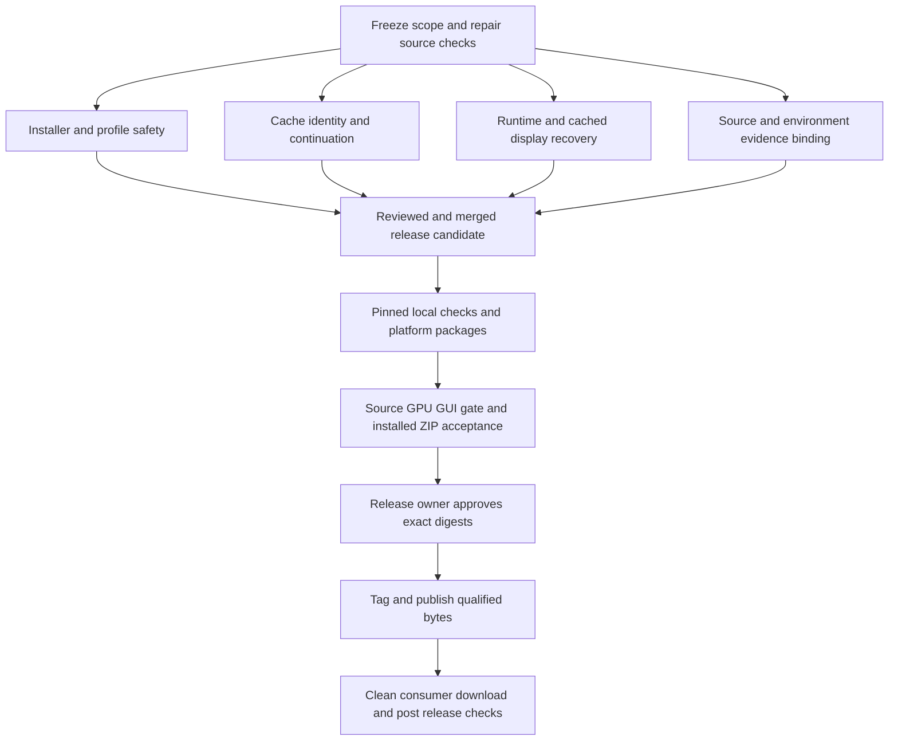

# FluidSim 4.1 Production Release Implementation Plan

> **For agentic workers:** REQUIRED SUB-SKILL: Use superpowers:subagent-driven-development or superpowers:executing-plans to implement this plan task-by-task. Steps use checkbox (`- [ ]`) syntax for tracking. Implementation has begun in isolated draft PRs; [the remediation status](../../REMEDIATION_STATUS_20261106.md) records current fixes, dependencies and remaining qualification. Unchecked acceptance steps are not claimed complete.

**Goal:** Deliver the existing FluidSim 4.1 feature set as an installable, recoverable, qualified release with trustworthy source/package/runtime evidence.

**Architecture:** Preserve the established settings, Admission, Solver Session, SceneInputs, Output Publication, Production Bake and I/O owners. Repair shared boundaries and extend their existing tests; use the existing local source/package and manual GPU/GUI gates, with final installed-artifact acceptance.

**Tech Stack:** Blender 5.2.0 certified distribution; Blender's bundled Python; Warp 1.19.0 / locked CUDA 13 wheels; NVIDIA R580-series-or-newer driver; pytest 9.1.1, Ruff 0.16.2, NumPy 2.3.4 for the pinned development lane. Windows x64 is the existing certified platform; Linux x64 requires separate qualification.

**Spec:** [Production readiness review, findings R1–R13](../../PRODUCTION_READINESS_REVIEW_20261106.md), [AGENTS.md](../../../AGENTS.md), [release procedure](../../RELEASING.md), [demo contract](../../DEMO_SCENE_CONTRACT.md), and the existing feature/cache/artist contracts referenced there. Reviewed baseline: `80bf4aaae0a108602ef1ef73cdf6c74e30dc8354`.

## Global constraints

- Keep simulation GPU-resident and preserve the sparse tiled leaf grid: fixed 8x8x8 leaves addressed through a flat leaf table.
- Run one production gate at a time on a host; reserve its GPU and Blender windows. Keep mandatory storage hooks and retain failed attempts.
- Every factory-startup Blender subprocess uses private absolute config/scripts/extensions/datafiles paths; the canonical isolated launcher owns GUI processes.
- Do not restore removed GitHub Actions workflows or policy-drift artifacts. Qualification uses local checks and manual target-host gates.
- ST-FLIP is permanently removed from project scope. Native GPU interop and particle-surface rendering APIs are reactivated for recovered-source review and new isolated implementation/validation plans only; their merge/release is not authorized by that scope decision. Keep them outside this stabilization candidate unless separately reviewed and qualified. Keep learned pressure guessing hidden/off and ship no weights.
- Preserve nine canonical demos: dam_break, crown_splash, paddle_stir, chromatic_vortex, buoyancy_ladder, water_wheel, viscosity_race, deep_plunge, capillary_droplet.
- Keep existing numerical/performance thresholds. Four-demo performance evidence does not certify the five newer demos. Never change tolerances after a failing run to obtain a pass.
- GPU/GUI/installed-package claims require those actual boundaries. Missing required hardware, results or skips block that claim.
- Publish the qualified ZIP bytes, not a rebuild assumed equivalent. Never retarget an existing release tag.
- Preserve supported old frame-cache playback. Refuse continuation only when required identity/frozen-state proof is unavailable; permit safe reconstruction for legacy checkpoints when provable. A blanket checkpoint format bump or blanket old-cache refusal is not required by the Warp upgrade. Review any unavoidable compatibility change before implementation.

## Review focus

1. Same-count topology, pointer and VDB-content edits must invalidate continuation (Task 3).
2. FIRST_SIM_FRAME and Static inputs must survive fresh-process resume while EVERY_SIM_FRAME velocity history stays correct (Task 4).
3. Exceptions after solver authority transfer must leave truthful usable/inactive state (Task 5).
4. Productive interrupted downloads, foreign Warp and offline installation must preserve user runtime/profile state (Tasks 2 and 7).
5. Reverted dirty measurements, changed host runtimes and rebuilds must never borrow unrelated qualification (Tasks 8–11).

## Scope, sequence and decisions

Recommended scope is stabilization of the already-landed 4.1 features, Warp 1.19, exclusive Preview/Surface/Off display policy and reversible Deck navigation. Do not add Surface Nets, new solver methods, exporters or demos. Remote refs checked during the preceding GitHub sync listed v4.0.0 and v4.0.1, with no v4.1 tag; recheck tags and GitHub releases before reserving 4.1.0. If already published by then, select the next unused patch version rather than replacing it.

Recommended delivery is Windows production first, with Linux held to its own qualification gate. If launch must promise equal Windows/Linux support, both gates become prerequisites for the same publication. Merely building a Linux archive never satisfies that requirement. Treat any earlier Linux preview distribution as a separate explicit scope decision.

Suggested planning allowance: roughly **8–15 engineer-days**, plus hardware availability and owner review, with cache-state remediation the largest uncertainty. This is an estimate, not a measured delivery commitment. Bootstrap/tooling tasks can proceed independently; cache identity precedes continuation compatibility; final qualification waits for all product/verifier changes. Nominate individuals for release owner, runtime/cache engineer, qualification engineer and independent reviewer at kickoff.

## Task 1 — Establish the candidate and restore the documented source checks

**Files:** Modify `tests/cache_io/test_frame_output.py`, `tests/perf/test_performance_hotpath_contracts.py`, `tests/runtime/test_settings_getattr_names.py`, `fluidSim_warp_blender51/tests/test_properties_ui_contract.py`, `fluidSim_warp_blender51/tests/test_properties_ui_release_source.py`; regenerate `docs/ownership-map.md` with `tools/ownership_map.py`; update `docs/RELEASING.md` and `fluidSim_warp_blender51/CHANGELOG.md` when final scope is known.

**Interfaces:** Consumes the exact review SHA and existing source-gate commands. Produces a reviewed stabilization branch, passing host-independent checks, and a recorded target version/platform scope.

- [ ] Check current remote master, tags and releases; record any differences from the reviewed SHA. Review intervening changes before folding them into the candidate. Create an isolated development checkout and retain the existing working tree.
- [ ] Run storage task-start telemetry and register owned output paths, lease, budget and evidence retention before allocating packages/caches. Use fresh run directories; do not overwrite prior qualification attempts.
- [ ] Reproduce `test_output_cost_counters_separate_all_four_phases` without Blender. Give the test's material/output dependencies appropriate scoped doubles, or split host-independent policy from actual bpy work. Keep assertions for all four distinct counters; do not skip the test to make the lane green.
- [ ] Update the skipped-surface publication test to use the current `PublicationPayload` defaults, including retained-cache and viewport flags; preserve the assertion that skipped publication never swaps the existing mesh. Do not add production compatibility code solely for an obsolete `SimpleNamespace` fixture.
- [ ] Teach the settings scanner that `is_property_set` is an RNA method, not an authored field. Keep a negative control proving misspelled settings still fail. Regenerate `docs/ownership-map.md`, review the new `liquid_display_mode` ownership row, and run both ownership-map failures plus the full map suite.
- [ ] Resolve the two Ruff errors identified in the review. Run `python -m ruff check .` from the add-on root and the isolated test from the repository root. Expected: zero lint errors and the test passes without bpy.
- [ ] Run the complete pinned CPU suite and retain every skip reason. Expected: zero failures/errors; required Blender/CUDA cases are recorded as excluded, not passed.
- [ ] Commit the source-check repair separately for review. Record final feature scope and numbering decision; do not change version again after qualification.

## Task 2 — Repair installed Preferences and download continuation

**Files:** Modify `fluidSim_warp_blender51/preferences.py`, `fluidSim_warp_blender51/warp_installer.py`, `fluidSim_warp_blender51/tests/test_warp_installer.py`; create `tests/acceptance/blender_installer_preferences_acceptance.py` and wire it into the existing acceptance inventory.

**Interfaces:** Preserve `_download_wheel(url, destination, *, expected_sha256, expected_size, progress_callback=None) -> None` and the existing install operators. A successful download still requires exact locked size/hash. Preferences must draw before installation or CUDA availability.

- [ ] Add a test in the certified Blender runtime asserting every literal product `icon` is an allowed RNA enum; require the actual Preferences draw to reach both install controls. Replace the invalid `GPU` icon with a certified supported value, such as `PREFERENCES`, after checking that runtime's enum.
- [ ] Add `test_productive_sub_megabyte_interruptions_complete`: a 2,097,155-byte payload delivered in 65,536-byte retained segments must finish with exact SHA-256 after more than eight interruptions. Demonstrate failure before repair.
- [ ] Add boundary/no-progress cases: positive segments of 1 byte, 65,536, 1 MiB-1 and 1 MiB; eight consecutive zero-progress attempts stop; productive recovery resets the no-progress streak. Repeated HTTP-200 restart without increasing the retained high-water mark must remain bounded.
- [ ] Repair progress accounting independently of `_CHUNK_SIZE`. Preserve HTTPS, size/digest validation, useful local-file guidance and partial-file cleanup. Test ignored Range, short clean responses, wrong offsets/content and corrupt final checksum.
- [ ] Run `python -m pytest -q fluidSim_warp_blender51/tests/test_warp_installer.py`. Then run installed foreground Preferences acceptance on certified Blender: no Warp, good owned Warp, damaged owned Warp, foreign preloaded Warp, offline local-wheel install, cancellation and repeated clicks. Assert controls are visible and the loaded path belongs to the extension when installation succeeds.
- [ ] Commit reviewed host-tested source to a draft PR and retain failed transport/UI attempts. Keep the certified native UI matrix as an explicit prerequisite for release qualification; draft source commits do not claim that matrix passed.

## Task 3 — Make cache identity cover the actual consumed inputs

**Files:** Modify `fluidSim_warp_blender51/blender/cache_identity.py`, `blender/scene_inputs.py` or its existing evaluated-input helpers, `io/cache.py`/`io/cache_schema.py` as required; extend `tests/cache_io/test_cache_io.py`, `test_source_frame_stamp.py`, `test_cache_v3.py` and `tests/acceptance/blender_cache_v3_stamp_acceptance.py`.

**Interfaces:** Preserve `source_signature(scene, depsgraph=None) -> str`, `source_frame_stamp(scene, depsgraph, frame) -> str`, and `signature_bundle(scene, depsgraph=None) -> dict[str,str]`. Introduce an explicit input-identity schema version, proposed value `2`, in newly written identity records. Identity consumes resolved inputs used by production, including referenced role-NONE objects.

- [ ] Add failures for changed triangle connectivity with unchanged coordinates/polygon counts, same-count point movement, referenced-object replacement, changed referenced transforms, and same-path changed VDB content. Assert source signature or relevant frame stamp changes and Resume refuses before any cache mutation.
- [ ] Add contrasting controls: UI-only changes do not invalidate; unchanged effective inputs remain stable; unrelated role-NONE objects do not invalidate. Hash actual dependency payloads, not every scene object.
- [ ] Include resolved mesh topology, point coordinates and consumed attributes, volume sequence/frame/grid/content identity, and source dependency references in canonical records. Reuse existing evaluated geometry ownership and release temporary meshes deterministically.
- [ ] Add provenance/version checks to continuation decisions. Old identity records lacking required coverage must return a specific restart-required reason, preserve files, and remain eligible for supported read-only playback. Do not invent missing origin/source metadata.
- [ ] Run the cache identity/stamp/v3 tests, then a real partial bake → topology/native-input edit → Resume/Re-bake refusal case. Run a valid unchanged continuation control and measure hashing overhead on the normal user path.
- [ ] Commit identity and migration/refusal tests together; document cache compatibility in the changelog.

## Task 4 — Preserve frozen scene inputs across Resume and preview restoration

**Files:** Modify `fluidSim_warp_blender51/blender/scene_inputs.py`, `blender/production_bake.py`, `blender/simulation_admission.py`, `io/checkpoint.py`; extend `tests/cache_io/test_bake_integrity.py`, `tests/solver/test_solver_checkpoint_roundtrip.py`, `tests/cache_io/test_cache_v31_rigid.py`; create `tests/acceptance/blender_frozen_input_resume_acceptance.py`.

**Interfaces:** Add `SceneInputs.export_frozen_state() -> FrozenInputState` and `SceneInputs.restore_frozen_state(state: FrozenInputState) -> None`. Define `FrozenInputState` in `scene_inputs.py` with `schema_version=1`, validated metadata, and named non-object NumPy arrays. It represents frozen mesh/native inputs and Static colliders keyed by persistent source identity; no bpy object pointers or pickle. Production Bake owns capture/restore orchestration; the solver remains independent of bpy. Existing checkpoint format 2 remains the default unless a demonstrated serializer incompatibility requires an explicit version change.

- [ ] Add an uninterrupted-versus-resumed fixture whose FIRST_SIM_FRAME point/mesh input moves between start and checkpoint. Assert the effective frozen input remains the start input after fresh-process resume. Include volume sink/field and Static-collider siblings.
- [ ] Preserve EVERY_SIM_FRAME moving-collider velocity/history at the last committed frame. Add a contrasting test so fixing frozen inputs cannot reset dynamic history to frame_start.
- [ ] Persist frozen-state metadata/arrays in a versioned optional extension to existing checkpoint format 2 and bind them to its digest/source identity. Use namespaced non-object arrays and structured metadata; test serializer preservation. For an older checkpoint without this extension, reconstruct only from verified original admission-frame dependencies and compare their identity; otherwise refuse continuation with a precise restart-required reason. Preserve legacy frame playback. Do not claim missing state is complete or invent original snapshots. If format 2 cannot safely carry the extension, present the concrete compatibility failure and version-change policy for review before changing it.
- [ ] During Resume/Re-bake, restore the frozen input state separately from priming dynamic inputs at the checkpoint frame. Reject missing, mismatched or malformed state before replacing the active session or modifying the committed cache prefix.
- [ ] Capture the preview's input state before a bake. On finish/cancel/failure, restore its original playhead before preview-time dynamic synchronization, restore its frozen snapshots, then restore the solver. Assert a frame-5 preview baked through frame 20 does not admit frame-20 frozen inputs on return.
- [ ] Run the three host checkpoint/bake suites, the new actual Blender acceptance, existing rigid/narrow-band continuation tests and `blender_deforming_collider_bake_acceptance.py`. Enforce exact equality only for lanes with that established contract; use existing numerical tolerances for others. Record arrays and loaded runtime identity.
- [ ] Commit state serialization and continuation behavior with migration notes and lossless/corrupt-state tests.

## Task 5 — Make solver replacement failure states coherent

**Files:** Modify `fluidSim_warp_blender51/blender/scene_bridge.py`, `blender/simulation_admission.py`; extend `tests/runtime/test_session_runtime.py`, `tests/ui/test_simulation_admission.py`, `tests/acceptance/blender_simulation_admission_acceptance.py`.

**Interfaces:** Preserve the `Session.install_solver(candidate, *, profiler, device, scene_inputs, admitted_effects=())` entry point. Its contract must report authority transfer before fallible retirement, so Admission never disposes an installed candidate as though it were uncommitted.

- [ ] Use real Session/Admission with injected failures in old-input cleanup, old-runtime release and CUDA memory retirement. Test Initialize/Reinitialize and Reset separately; assert `session.active` never implies a released candidate.
- [ ] Make cutover ownership explicit, either by separating the atomic assignment from retirement or by returning a committed outcome before cleanup. Pre-cutover failures preserve the old solver; post-cutover failures retain a usable candidate or fully deactivate with a truthful error. Do not report “live solver preserved” when it was replaced/released.
- [ ] Run `python -m pytest -q tests/runtime/test_session_runtime.py tests/ui/test_simulation_admission.py` and actual admission acceptance, including repeated failures and the successful replacement control. Verify no double-release or stale binding.
- [ ] Commit this boundary repair independently of broad solver refactoring.

## Task 6 — Complete display adaptation and read only verified cache bytes

**Files:** Modify `fluidSim_warp_blender51/blender/pending_settings.py`, `blender/playback.py`, `blender/output_publication.py`, `io/cache.py`; extend `tests/runtime/test_scene_bridge_cache_playback.py`, `tests/ui/test_phase4_pending_interaction.py`, `tests/ui/test_liquid_preview.py`, `tests/cache_io/test_cache_v3.py`; create `tests/acceptance/blender_paused_cache_output_acceptance.py`.

**Interfaces:** Add `playback.refresh_current_cache_output(scene) -> None`, using existing verified cache reads/publication and explicitly bypassing same-frame cursor suppression. It must not initialize a solver. Keep `io.cache.read_frame`'s public result schema unchanged; hash and parse one immutable byte snapshot.

- [ ] Preserve the now-passing cached OFF→SURFACE/PREVIEW geometry-retention controls. Reproduce remaining Combined→Separate/Both whitewater and fraction edits while paused: six particles at fraction 1 must become three at fraction .5 immediately; typed foam must appear without advancing the frame. Cover attribute edits as a separate acceptance case and keep metadata-only changes cheap.
- [ ] Add live fallback-color tests with render/export particles disabled, HEIGHT/SPEED attributes enabled, and (a) meshing disabled, (b) empty extracted surface. Assert six visible fallback particles carry the same selected visualization values as the render-particles-enabled control and cached lane. Extend `prepare_live_payload` so actual viewport needs govern attribute gathering, including fallback discovered after extraction; never enable particle rendering as a side effect.
- [ ] Route geometry-dependent cached OUTPUT changes through current-frame republication. Preserve ordinary metadata updates and existing live-session semantics. Test the cache-only path with Warp unavailable.
- [ ] Inject a frame-file replacement after verification but before parsing; require either the originally verified snapshot or a checksum refusal, never unverified replacement bytes. Preserve size/schema/alignment checks and corruption behavior. Use the checkpoint reader's single-snapshot pattern; profile peak memory on a representative large frame.
- [ ] Run the three focused suites and real paused-cache acceptance; verify a representative VDB export reader as a sibling. Commit the two repairs separately if their tests can be reviewed independently.

## Task 7 — Isolate every package-build process from user profiles

**Files:** Modify `tools/release/build_extension.py`, `tools/release/run_local_gate.py` where needed; extend `fluidSim_warp_blender51/tests/test_build_extension.py` and `tests/repo/test_install_local.py`.

**Interfaces:** Reuse `_blender_process_environment` and existing smoke isolation. Every validate/build/generate/smoke subprocess receives explicit private absolute `BLENDER_USER_CONFIG`, `BLENDER_USER_SCRIPTS`, `BLENDER_USER_EXTENSIONS`, `BLENDER_USER_DATAFILES` and owned caches. The parent profile is never a build dependency.

- [ ] Add runner-capture tests asserting environment isolation for extension validate/build as well as smoke; demonstrate current omission before repair.
- [ ] Allocate one owned profile per build run and propagate it through all Blender subprocesses. Strip accidental developer import overrides for installed-package verification; preserve intentionally configured source-gate dependencies only in the source lane.
- [ ] In a disposable consumer profile with a sentinel extension/wheel, run successful and failing builds. Assert the sentinel inventory is unchanged and only owned processes/paths are cleaned up.
- [ ] Run build/install-local tests. Build and inspect both platform archives with certified Blender; assert the nine demos/resources/licenses exist and no Warp wheel/developer test output is bundled. Commit isolation and its tests before any production-host build.

## Task 8 — Bind qualification to source, verifier and observed environment

**Files:** Modify `tools/run_production_gate.py`, `tools/benchmark_versions.py`, `tools/benchmark_demo_trial.py`, `tools/performance_budget.py`, `tools/release/validate_phase5_blender.py`, `tools/release/validate_properties_ui_blender.py`; extend `tests/gate/test_production_gate_semantics.py`, `test_production_gate_truthfulness.py`, `test_demo_budget_runner.py`, `test_performance_evidence_integrity.py`, `test_performance_budget.py`.

**Interfaces:** Existing summary/manifests gain required `source_fingerprint`, `verifier_fingerprint`, `run_id` and `environment_fingerprint` fields. The environment includes observed Blender version/build/executable SHA-256, bundled Python identity, Warp version/distribution/wheel SHA-256/loaded path, OS/architecture, GPU UUID/model and driver. Compatibility policy and measured observation remain separate fields.

- [ ] Add negative controls: dirty solver measurement; reverted dirty measurement at same HEAD; mid-run source edit/commit; missing report; stale manifest after failed admission; wrong Warp; changed GPU/driver/Blender/platform. Each must reject the intended condition for a specific reason.
- [ ] Freeze HEAD and relevant source/verifier bytes before admission; check again before issuing a receipt. Refuse arbitrary dirty product inputs. Define an explicit generated-demo exception with before/after hashes and semantic comparison; it must not permit add-on code differences.
- [ ] Require immutable per-demo measurement-source and environment fingerprints for reuse. Missing/legacy provenance triggers remeasurement, not promotion. Bind raw trials and summaries to retained reports, evaluator and baseline inputs; protect baseline/policy pins from candidate modification.
- [ ] Remove Blender 5.1 fallback/exemptions from release qualification. Fail early unless certified Blender and its bundled Python resolve to the approved distribution. Retain the local gate's executable digest/provenance check and use equivalent production preflight.
- [ ] Invalidate or distinguish the current invocation's receipt before storage admission, while retaining old evidence in its own run directory. Write final receipts atomically only after all mandatory results pass and source/runtime identity remains unchanged.
- [ ] Run `python -m pytest -q tests/gate fluidSim_warp_blender51/tests/test_release_scripts_source.py`. Rerun the retained budget-binding probe as a negative regression: its formerly accepted dirty/wrong-runtime cases must now be refused.
- [ ] Commit verifier hardening before measuring a release budget. Never repair a prior receipt by editing its SHA or verdict.

## Task 9 — Freeze the reviewed release candidate and platform profiles

**Files:** Update `fluidSim_warp_blender51/version.py`, `blender_manifest.toml`, `CHANGELOG.md`, `docs/RELEASING.md`, `docs/RELEASE_4_1_PLAN.md` status pointer; create `docs/RELEASE_4_1_QUALIFICATION.md` as the compact result index. Keep generated/raw reports in owned artifact storage.

**Interfaces:** Produces one immutable candidate commit, an approved compatibility/support statement, and per-platform qualification profiles. Existing manifests, locks and version constants must agree.

- [ ] Review/merge remediation through normal repository PR/owner review. Include intervening changes in review scope. Preserve historical reports; point superseded plan status at the new plan instead of rewriting history.
- [ ] Reconcile docs with actual Warp 1.19.0, driver floor, Windows certification, Linux status, all nine demos, supported cache/file upgrades, and the newly landed fixes. Keep Alembic particle limitations and learned-guess restrictions explicit.
- [ ] Freeze official Blender distribution provenance and reviewed executable hash; pinned tool/dependency versions; exact locked wheels; GPU/driver/OS; source/verifier/fixture hashes; required cases and inherited numerical thresholds. No placeholder can qualify a candidate.
- [ ] Verify required historical performance baseline commits and assets are available without reactivating archived experiments. Record canonical demo/result reference hashes; explain expected changed results before measurement.
- [ ] Freeze smoke/soak policy before running it: proposed minimum 60 minutes of representative preview/bake/cache cycling and 20 load/reset/bake-cancel cycles, no crash/leaked active lease/data loss. Record memory/VRAM plateaus and interaction timings; approve any new numeric budget before measuring it. These are proposed additional gates, not existing certified metrics.
- [ ] Obtain independent review of fixes and the requirements-to-test matrix. Merge to the release commit before final qualification; no later product or verifier edits inherit its receipts.

## Task 10 — Run pinned source, physics, GPU and GUI qualification

**Files:** Existing acceptance/tests/gates; add the new cases from Tasks 2/4/6 to the production gate's required inventory and coverage tests. Write evidence under the registered run root, then copy/index the gate's conventional artifacts without editing them.

**Interfaces:** Produces mandatory lane results linked to one source/verifier/environment/run identity. `FULL-PRODUCTION-GATE-PASS` is accepted only with a matching complete manifest and underlying evidence.

- [ ] On each claimed platform, run `python tools/release/run_local_gate.py --output <owned-output> --blender <certified-blender> --blender-sha256 <approved-sha256>` in the pinned clean environment after Task 7. Expected: clean source checks, CPU validators, package smoke and `LOCAL-GATE-PASS`; no required case silently skipped.
- [ ] Reserve the NVIDIA host, capture observed runtime/loaded module paths, verify driver/device usability and actual workload CUDA execution, and run one gate at a time. Point `BLENDER_EXE`, `BLENDER_PY` and source-lane `PYTHONPATH` at the approved runtime.
- [ ] Run `python -u tools/run_production_gate.py --include-gui --measure-budget` with durable logs. Fresh Warp 1.19 measurement is mandatory for this dependency change, provenance repair and first platform qualification. The current source pins explicitly have no completed 1.19 GPU campaign; do not reuse 1.18 output hashes as proof of equivalence. The wrapper supplies its storage hooks and private extension path. Expected: all mandatory lanes, all-demo checks and performance checks pass; a complete final manifest names the frozen candidate.
- [ ] Run `python tools/demos/analyze_demos.py`; require all canonical checks, presently 21/21. Run `paddle_stir` analysis separately (10/10 expected by the current contract). Require `check_demo_blends.py` to cover all nine demos, plus feature-specific evidence for the five newer demos.
- [ ] Run focused additions not yet included in the wrapper using isolated factory-startup Blender with `--python-exit-code 1`. Do not call a source helper as proof of installed delivery. Retain every required marker, exit status, JSON report, meaningful output and negative control.
- [ ] Review quantitative accuracy/performance against the current evaluator: recorded transition budgets are crown 1.155, dam/paddle 1.10, vortex 1.05; applicable Multigrid residual limit 6.0, otherwise 1.10. The evaluator determines applicability from actual settings; these numbers do not license unexplained allowances. Preserve ABBA/BAAB ordering and the existing 0.06 early-stop margin.
- [ ] Do not repeat passing full gates just to accumulate passes. A failure requires diagnosis, repair and affected requalification; keep failed runs. A product/verifier change creates a new candidate and new receipt.

### Required workflow coverage

| User outcome | Existing anchors and additions | Required proof |
| --- | --- | --- |
| Install and start | Task 2; installer/warp runtime tests; installed Preferences | Both installation routes usable, exact owned wheel/path, foreign/offline/corrupt refusals |
| Author and preview | artist workflow, 4.1 UI, Deck defects/gizmo, source UI acceptance | Actual controls alter intended owned settings; both wheel entry points navigate reversibly; hit targets survive scale/resize/multi-viewport; pause/resume/apply/undo/load behave correctly |
| Simulate core liquid | pressure/hydrostatic/sparse-grid/source/force/viscosity/surface-tension suites | Actual CUDA kernels, finite outputs, existing accuracy/volume thresholds |
| Preserve feature behavior | rigid-contact/publication, narrow-band, APIC, whitewater, color/effects acceptance | Dynamic contact/poses, volume, attributes and trusted effects exercised, not just configured |
| Bake/resume/recover | checkpoint/cache/bake integrity; Task 4; load/deleted-scene/cancel acceptance | Interrupted vs uninterrupted control; committed prefix intact; frozen/dynamic input history correct |
| Read cache without Warp | playback/animated cache; Task 6 | Preserve working liquid mode cycling; same-frame whitewater/fraction edits work; no solver admission; corrupt/mismatched bytes refused |
| Export | USD, Alembic, VDB production/export acceptance | Reopen exports independently; correct transforms/attributes/rigids; no empty claimed particle export |
| Run the demos | all-demo gate plus feature assertions | All nine reopen at start, create nonempty solver, advance real handlers and publish changing owned output |
| Recover resources | memory safety, admission, handler persistence; Task 5 | Bounded memory behavior, safe allocation refusal, repeated lifecycle cleanup, truthful errors |
| Enforce policy | gate/installer/effect/cache negative controls | Wrong build, no CUDA/fallback, wrong wheel, untrusted effect, missing result and stale evidence rejected intentionally |

## Task 11 — Qualify and retain the exact installed ZIPs

**Files:** Extend `tools/release/build_extension.py`, `smoke_test_blender.py`, `gpu_regression_blender.py` and the existing acceptance adapter only as needed to select installed modules instead of `enable_repo_addon`; extend `fluidSim_warp_blender51/tests/test_build_extension.py` to enforce that route.

**Interfaces:** Produces a delivery record linking candidate SHA, both archive SHA-256s, installed member inventories, observed module paths, platform-specific GPU/GUI reports, final manifest and baseline identity. Planned installed acceptance must fail if it loads source from the repository.

- [ ] Build packages once from the frozen candidate in an isolated profile and owned output directory. Record checksums and inspect complete contents. If source-gate demo rebuilding changes distributed demo bytes, either prove explicit semantic equivalence and bind both inventories or commit final demo inputs and requalify the affected candidate; do not conceal the difference.
- [ ] Install each target platform archive into a clean consumer profile with the repository absent from `sys.path`. Assert all installed member hashes match that archive and runtime module paths resolve inside the installed extension/owned dependency directories.
- [ ] Run installed source-independent GPU regression and representative actual GUI author → preview → bake → cancel/resume → cache playback → export → reopen workflows. Cover Preferences, Deck navigation/click targets, live fallback attribute coloring, Preview/Surface/Off, frozen-input resume and paused cache fixes. Use actual framebuffer/output-object checks and ensure viewport toggles preserve render/export choices. Validate capability rejection by deliberately making CUDA unavailable in a separate disposable control; it must refuse for the intended reason.
- [ ] Test upgrade from retained supported 3.2.1/4.0.x packages and representative 1.1+ saved files; preserve pre-1.1 refusal. Verify old frame-cache playback, explicit old-checkpoint restart guidance, preferences retention, repeated enable/disable and uninstall/reinstall. Preserve test copies of user scenes/caches.
- [ ] Exercise a second process trying to own the same cache directory. Require safe refusal/recovery before advertising concurrent production use. Test crash recovery at frame write/checkpoint write/manifest replace and disk-full/permission-denied conditions using disposable caches.
- [ ] Complete the predeclared soak/lifecycle matrix. Retain raw timing/memory observations and distinguish CPU fallback, synthetic output and true CUDA execution.
- [ ] Run Linux GPU/GUI/USD/OpenVDB acceptance on Linux hardware if Linux will be claimed production-ready. Windows evidence cannot fill this row. Keep Linux BLOCKED until the hardware and every mandatory case are available/passing.
- [ ] Seal the evidence set with hashes and an immutable archive of the exact tested packages. No subsequent rebuild is substituted under those digests.

## Task 12 — Release signoff, publication and consumer verification

**Files:** Finalize `docs/RELEASE_4_1_QUALIFICATION.md`, changelog/release notes and retained `SHA256SUMS.txt`; reference externally retained raw evidence rather than committing caches/logs wholesale.

**Interfaces:** Produces a release with tag→commit→ZIP→installed evidence traceability. This plan does not authorize publication; obtain the release owner's approval of the concrete version, platform claims, notes and exact archive digests after all prerequisites exist.

- [ ] Independent reviewer verifies all R1–R13 dispositions, zero required failures/skips, source/runtime/package identity, failed attempts retained, platform scope and known limitations. No open P1 or data-integrity failure can be waived by a green metadata report.
- [ ] Confirm the final candidate is merged, immutable, and the desired version/tag unused. Prepare the exact release notes, package list, checksums, manifests and qualification index for owner signoff. Record any narrower Linux scope explicitly.
- [ ] After authorization, create the annotated `v<version>` tag at the qualified merged SHA and publish the prepared release with the already-qualified Windows/Linux artifacts appropriate to the approved scope. Attach `SHA256SUMS.txt`, production manifest and compact qualification record. Do not build after tagging and assume equivalence.
- [ ] Download the public release through the actual consumer channel into a fresh profile; verify its checksums against the sealed delivery record, install, provision Warp through the public UI/local wheel path, and run a short representative CUDA preview/bake/reopen check. Verify release links, version/build display and upgrade notes.
- [ ] Update the owner's Blender only as an explicit installation step: `python tools/release/install_local.py --blender <approved-exe> --zip <qualified-package>`, adding `--install-warp` only when dependency download is intended. Keep evidence of loaded versions/paths and CUDA capability.

## Task 13 — Rollback, support and post-release ownership

**Files:** Add a recovery/support section to `docs/RELEASING.md` and publish a concise known-issues/recovery entry with the release. Preserve previous qualified archives and checksum records.

**Interfaces:** Release owner owns stop-ship/rollback; runtime engineer owns data/simulation triage; qualification engineer reproduces installed failures. Support intake captures versions, OS/GPU/driver, loaded module paths, reproduction steps and diagnostic report without requiring secrets or private assets.

- [ ] Before publication, rehearse rollback in a disposable profile: stop simulation/bake, save a separate scene copy, retain cache/checkpoints, disable the extension, install the previous known-good archive and restart Blender. Verify dependency compatibility and never swap native Warp libraries inside a running process.
- [ ] Treat scene/cache downgrade separately from code rollback. Do not open/overwrite the only copy of newer data with older code. Preserve new-format caches for read/export or rebake from an appropriate scene copy; refused continuation is not repaired by relabeling metadata.
- [ ] Trigger stop-distribution/rollback for confirmed data loss, unsafe cache acceptance, install-blocking regressions, reproducible crashes or failure of published artifact identity. Preserve the published tag/history; withdraw the affected asset/release only with owner authorization and issue a new patch release rather than mutating qualified bytes.
- [ ] Assign daily triage for the first 72 hours and a seven-day review. Repeat public download/install smoke at launch and after any asset/hosting change, not all physics gates on a timer. Track install success/failure reports, crash/OOM reports, cache corruption/resume defects and observed performance regressions; do not add unsolicited telemetry.
- [ ] Close the release when consumer checks pass, support/rollback owners are named, evidence retention is reconciled and no unresolved stop-ship issue remains. Retain protected failure/qualification evidence; cleanup of disposable output follows the existing recoverable storage policy.

## Execution handoff and completion rules

This plan supersedes the earlier same-day draft based on 502ca66. Prior documents and evidence are retained under `/workspace/scratch/fluidsim-review-80bf4aa-20261106/prior-documents`. The current review is complete; this plan is not yet executed. Tasks 1–8 address known defects and verification failures. Tasks 9–11 establish the final candidate and truthful qualification. Tasks 12–13 cover controlled delivery and operation. Source/packaging edits need review before final qualification; external publication is the last approval-dependent action, after exact packages and evidence are available.

Completion requires the full requirements-to-test matrix, exact tested package identities, clear platform claims, owner signoff, public consumer verification and a rehearsed rollback. A lint pass, unit-test count, `release_ready: true`, historical gate, or missing failure report cannot substitute for these outcomes.
