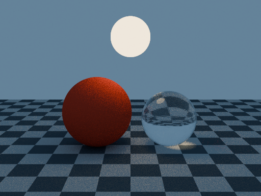

# FSPT P1 evidence — 25 November 2026

**Experimental foundation verified within the scope below. Full production
qualification remains open.** This is a static renderer validation fixture;
it is not a FluidSim simulation demo or a performance benchmark.

**Provisional canonical FSPT image.** Actual output from code revision
`3a0622d2340e062afc7bc362052232a276d9d485`, captured 25 November 2026
(America/New_York): Blender 5.2.0 `fbe6228777e7`, Warp 1.18.0, RTX 4080 SUPER;
512 × 384, 128 samples, six bounces, seed 31. The original PNG, linear EXR and
saved static scene are retained under [final/preview](final/preview/).
[Preview report](final/preview.json), [provenance](final/preview-provenance.json)
and [reproduction script](create_preview.py). The later source change corrects
an unsupported-geometry diagnostic; optical code is unchanged. Reopening the
scene as a user workflow was not qualified.

## Identities

| Item | Exact identity |
| --- | --- |
| Base | `df8b72bed7967ff7ce855099335c762577f89b0f` |
| Experimental branch | `experimental/fspt-p1-20261125` |
| Final code commit | `0ece56afe51b88b3a42f7596b65ba58f750f36b5` |
| Windows extension ZIP SHA-256 | `92538a05e236b470fa659db7637c3cab9ba8bb79ac0a5923015f579b5224713d` |
| Linux extension ZIP SHA-256 | `d85ecdc5893a13ed23c8c5c6c2c67214f979e8c0ff481b02d7d7ecf6433e8210` |
| Source Python tree SHA-256 | `00215ba75e4e0e72b81a8526327b9639f078a726c280225f0bebf3430552735f` |
| Installed Python tree SHA-256 | `a3fd7be6b719a7c3d0f0ca77b3a9a47ab2dfc5d60271e6bb9304e322b429c244` |
| Canonical PNG SHA-256 | `efda40cc25fb79e0556402d9c829342f9cae4d97b3e2563182e4966c2b682738` |

The source tree includes 69 test files omitted from the extension. All **186
packaged Python files** match the source and installed payload byte for byte;
there are no installed-only Python files. See [payload identity](final/payload-identity.json).
The existing packager inspected both platform archives. Only the Windows
archive received runtime acceptance. Archives remain in the isolated Windows
worktree under `artifacts/fspt-p1/package/`; these are experimental 4.1.0 builds,
not a published release. The original canonical checkout was preserved.

## Verification

| Lane | Result and evidence |
| --- | --- |
| Focused host checks | **79 passed**, CUDA hidden; contracts, material boundaries, registration, GPU-failure ownership controls and acceptance inventory. [Log](final/source-final-79.txt) |
| Source camera rendering | **Verified, exit 0**: finite opaque EXR/PNG, camera/material image changes, CPU refusal, unsupported graph refusal without output, constant-world control and unregister. [Report](final/render.json) |
| Analytic and rejection controls | **15 verified, exit 0**: slot and layer overrides, muted graph, mixed point geometry, anonymous GeometrySet, IOR-1 transmission, TIR, perspective/orthographic clipping, diffuse bounce depth, output guards and a successful render after refusal. [Report](final/edges.json) |
| Windowed Blender viewport | **Verified, exit 0**: autonomous refinement from one to eight samples at all four stages; camera/material edits visibly change pixels; resolution scale change resets history. [Report](final/viewport.json), [original captures](final/viewport-captures/) |
| Installed Windows extension | **Verified** through the existing packager/private installer: real camera rendering and controls load `bl_ext.fluidsim_ci.fluidsim_warp` from the installed directory. [Build report](final/package.json), [installed report](final/installed.json) |
| Independent reviews | **Both pass for bounded P1** at the exact final code SHA. Optical transport and integration reviews are separate from runtime/release qualification. [Dispositions](final/reviews.md) |

[Terminal receipts](final/terminal-receipts.json) bind standalone process exits,
pass markers and log digests. Package command results and five step logs are
retained in `final/`. The source render, edge and viewport runs use the same
Python payload fingerprint. Blender jobs used automatic blender-gate routing,
private profiles and bounded leases. Shared-run durations are diagnostic,
not performance acceptance.

Runtime: Windows 11 `10.0.26200-SP0`, Blender 5.2.0 LTS `fbe6228777e7`,
Python 3.13.13, Warp 1.18.0, NVIDIA RTX 4080 SUPER. The renderer explicitly uses
CUDA with Warp software-BVH traversal and host-staged RGBA32F presentation.
It does not claim RTX/OptiX traversal or zero-copy presentation.

## Failed attempts and remaining gates

The first unsupported-render negative control exposed a native Blender crash.
The engine now reports `ERROR` through Blender's render-engine API so rejected
output is cancelled before image writing. Later GPU fault, material/camera and
anonymous-instance regressions failed before their corrections. The edge
harness initially left Blender's expected-render-abort flag set and exited 1;
the final harness proves recovery through a real successful render and requires
exit 0. Failures remain in the owned worktree, with a retained history manifest.

The broader host suite timed out after 300 seconds. Its identified acceptance
inventory failure was fixed and the focused inventory checks passed; **the
broader suite is not passing evidence**. The normal production gate was invoked
from `3a062` and stopped at missing reviewed `BLENDER_SHA256` runtime provenance.
[Production attempt](final/production-gate.json) and [log](final/production-gate.txt).
The prototype's Warp 1.18 profile does not qualify the certified Warp 1.19
environment. No full production gate, merge or release is claimed.

Verified scenes use ordinary unit scales near the origin. Live fluid bridging,
changing topology and animation, active-engine disable/re-enable, cancellation,
physical viewport resizing, general shader/light compatibility, absorption,
nested/rough media, smooth shading normals, MIS/NEE, passes, sequences,
reconstruction and performance remain open. Thin or far-from-origin geometry
needs a stronger ray-offset bound and explicit controls before extending the
claim. The original P2–P6 endpoint and proposed benchmark ladder are preserved.

Next development work is the remaining P0 compatibility/backend contract and
P2 publication bridge with changing-count fluid geometry, frame identity and
thin-interface optical controls. [Implementation record](../../docs/fspt/P1_IMPLEMENTATION.md)
and [roadmap](https://chatgpt.com/space/page_e736fb28ec2881918bc688878f62ab03).
